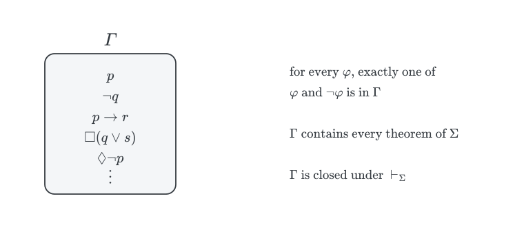
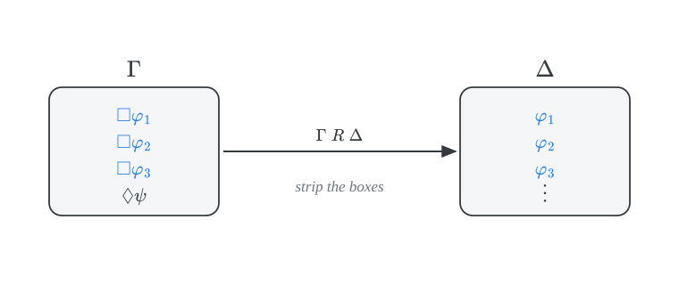
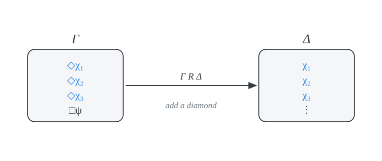
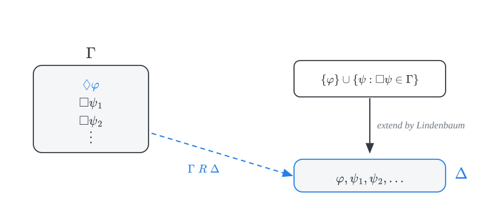
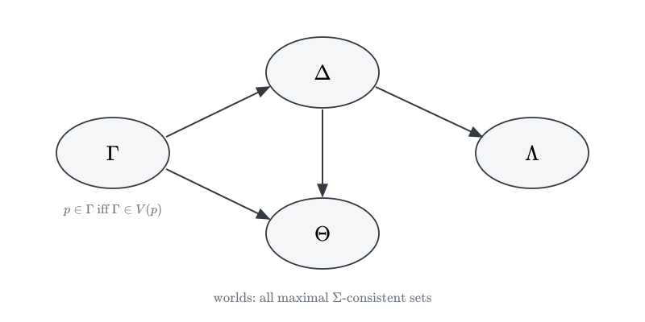
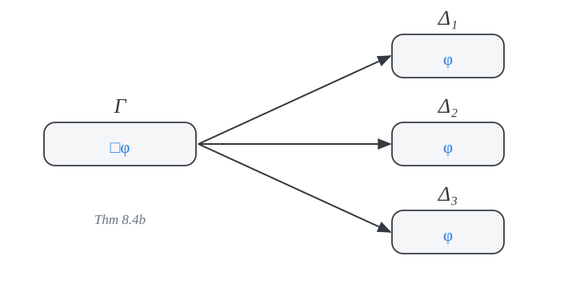

# canonical models {.divider}

We want to show that a normal modal system $\Sigma$ **characterizes** a class of frames $\mathcal{C}$:
$$\vdash_\Sigma \varphi \quad \text{iff} \quad \models_{\mathcal{C}} \varphi$$

## soundness and completeness

::: {.incremental}
- **Soundness** ($\Rightarrow$): the axioms of $\Sigma$ are valid in every frame in $\mathcal{C}$ and the rules preserve validity in $\mathcal{C}$.

- **Completeness** ($\Leftarrow$): we argue by contraposition. If $\nvdash_\Sigma \varphi$, then $\varphi$ fails at a world of some model based on a frame in $\mathcal{C}$.

- The model we build is the **canonical model** $\mathcal{M}_\Sigma$ for $\Sigma$.

- The main task will be to verify that the canonical frame belongs to $\mathcal{C}$.
:::

## the strategy

{.nostretch width="90%" fig-align="center"}

. . .

Each arrow will be justified in this deck: Theorem 8.1, Lindenbaum's lemma, and the Truth Lemma.

# consistency {.divider}

## derivability

::: {.definition}
$\varphi$ is **$\Sigma$-derivable** from $\Gamma$, written $\Gamma \vdash_\Sigma \varphi$, iff there is a finite conjunction $\boldsymbol{\alpha}$ of formulas $\alpha_1, \dots, \alpha_n \in \Gamma$ for which
$$\vdash_\Sigma \boldsymbol{\alpha} \to \varphi$$
:::

. . .

We make no allowance for premises *inside* a derivation. Otherwise $\textsf{RN}$ would let us infer $p \vdash_\Sigma \Box p$, which is undesirable.

## consistency

::: {.definition}
$\Gamma$ is **$\Sigma$-consistent** iff $\Gamma \nvdash_\Sigma \bot$: there is no finite conjunction $\boldsymbol{\alpha}$ of members of $\Gamma$ for which
$$\vdash_\Sigma \boldsymbol{\alpha} \to \bot$$
:::

. . .

- Otherwise, $\Gamma$ is **$\Sigma$-inconsistent**.

- $\varphi$ is $\Sigma$-consistent iff $\{\varphi\}$ is, i.e., iff $\nvdash_\Sigma \varphi \to \bot$.

- In particular, $\nvdash_\Sigma \varphi$ iff $\neg \varphi$ is $\Sigma$-consistent.

## derivability and inconsistency {.smaller}

::: {.theorem}
$\Gamma \vdash_\Sigma \varphi$ iff $\Gamma, \neg \varphi$ is $\Sigma$-inconsistent.
:::

::: {.proof}
($\Rightarrow$) If $\vdash_\Sigma \boldsymbol{\alpha} \to \varphi$, then $\vdash_\Sigma (\boldsymbol{\alpha} \wedge \neg \varphi) \to \varphi$, and so $\vdash_\Sigma (\boldsymbol{\alpha} \wedge \neg \varphi) \to \bot$ by $\textsf{PL}$. So $\Gamma, \neg\varphi$ is $\Sigma$-inconsistent.

($\Leftarrow$) Suppose $\vdash_\Sigma (\boldsymbol{\alpha} \wedge \neg \varphi) \to \bot$ for some conjunction $\boldsymbol{\alpha}$ of members of $\Gamma$. Since $\vdash_\Sigma \neg \bot$, we have $\vdash_\Sigma \neg(\boldsymbol{\alpha} \wedge \neg \varphi)$, whence $\vdash_\Sigma \boldsymbol{\alpha} \to \varphi$ by $\textsf{PL}$. So $\Gamma \vdash_\Sigma \varphi$.
:::

# maximal consistency {.divider}

## maximal $\Sigma$-consistent sets

::: {.definition}
$\Gamma$ is **maximal $\Sigma$-consistent** iff

1. $\Gamma$ is $\Sigma$-consistent, and
2. for each $\varphi$, if $\Gamma, \varphi$ is $\Sigma$-consistent, then $\varphi \in \Gamma$.
:::

. . .

::: {.theorem}
(**Lindenbaum**) Every $\Sigma$-consistent set can be extended to a maximal $\Sigma$-consistent set.
:::

. . .

Enumerate all formulas $\varphi_1, \varphi_2, \dots$ and add each in turn whenever doing so preserves $\Sigma$-consistency.

## a maximal consistent set as a world

{.nostretch width="72%" fig-align="center"}

A maximal $\Sigma$-consistent set gives a complete and consistent description of how things might be. These will be the worlds of the canonical model.

## decomposition {.smaller}

::: {.theorem}
If $\Gamma$ is maximal $\Sigma$-consistent, then

$$
\begin{array}{llll}
1. & \Gamma \vdash_\Sigma \varphi & \text{iff} & \varphi \in \Gamma \\
2. & \neg \varphi \in \Gamma & \text{iff} & \varphi \notin \Gamma\\
3. & \varphi \to \psi \in \Gamma & \text{iff} & \varphi \notin \Gamma \ \text{or} \ \psi \in \Gamma \\
\end{array}
$$
:::

::: {.proof}
1 ($\Rightarrow$) If $\Gamma \vdash_\Sigma \varphi$, then $\Gamma, \neg\varphi$ is $\Sigma$-inconsistent. If $\varphi \notin \Gamma$, then $\Gamma, \varphi$ would be $\Sigma$-inconsistent too, which would make $\Gamma$ itself $\Sigma$-inconsistent. So $\varphi \in \Gamma$. ($\Leftarrow$) Since $\vdash_\Sigma \varphi \to \varphi$.

2 ($\Rightarrow$) If $\neg \varphi \in \Gamma$, then $\Gamma \vdash_\Sigma \neg\varphi$, so $\varphi \notin \Gamma$ by consistency. ($\Leftarrow$) If $\varphi \notin \Gamma$, then $\Gamma, \neg\neg\varphi$ is $\Sigma$-inconsistent, and so $\Gamma \vdash_\Sigma \neg \varphi$ by Theorem 8.1.

3 is analogous.
:::

# accessibility {.divider}

## the canonical relation

::: {.definition}
For maximal $\Sigma$-consistent $\Gamma, \Delta$:
$$\Gamma R \Delta \quad \text{iff} \quad \{\varphi : \Box \varphi \in \Gamma\} \subseteq \Delta$$
:::

{.nostretch width="62%" fig-align="center"}

## an equivalent characterization

::: {.theorem}
$\{\Diamond \varphi : \varphi \in \Delta\} \subseteq \Gamma$ iff $\{\varphi : \Box \varphi \in \Gamma\} \subseteq \Delta$
:::

{.nostretch width="62%" fig-align="center"}

## proof {.smaller}

::: {.proof}
($\Rightarrow$) Suppose $\{\Diamond \varphi : \varphi \in \Delta\} \subseteq \Gamma$ and $\Box \varphi \in \Gamma$. For reductio, suppose $\varphi \notin \Delta$. Then $\neg \varphi \in \Delta$, so $\Diamond \neg \varphi \in \Gamma$, i.e., $\neg \Box \neg\neg \varphi \in \Gamma$. Since $\vdash_\Sigma \neg \Box \neg \neg \varphi \leftrightarrow \neg \Box \varphi$, we get $\neg \Box \varphi \in \Gamma$, and so $\Box \varphi \notin \Gamma$. Contradiction.

($\Leftarrow$) Suppose $\{\varphi : \Box \varphi \in \Gamma\} \subseteq \Delta$. We show: if $\Diamond \varphi \notin \Gamma$, then $\varphi \notin \Delta$. If $\neg \Box \neg \varphi \notin \Gamma$, then $\Box \neg \varphi \in \Gamma$ by maximality. So $\neg \varphi \in \Delta$, and $\varphi \notin \Delta$.
:::

## $\Diamond$ and $\Box$ in maximal consistent sets

::: {.theorem}
If $\Gamma$ is maximal $\Sigma$-consistent, then

$$
\begin{array}{llll}
\text{a.} & \Diamond \varphi \in \Gamma & \text{iff} & \text{for some} \ \Delta, \ \Gamma R \Delta \ \text{and} \ \varphi \in \Delta\\
\text{b.} & \Box \varphi \in \Gamma & \text{iff} & \text{for every} \ \Delta, \ \text{if} \ \Gamma R \Delta, \ \text{then} \ \varphi \in \Delta
\end{array}
$$
:::

. . .

- The right-to-left direction of (a) is immediate from the definition of $R$.

- (b) follows from (a) by duality.

- The interesting direction is (a) from left to right: the **existence lemma**.

## the existence lemma

If $\Diamond \varphi \in \Gamma$, we need to *build* an accessible $\Delta$ containing $\varphi$:

{.nostretch width="72%" fig-align="center"}

Anything containing $\{\psi : \Box \psi \in \Gamma\}$ is accessible from $\Gamma$, so it suffices to show that $\{\varphi\} \cup \{\psi : \Box\psi \in \Gamma\}$ is $\Sigma$-consistent.

## proof {.smaller}

::: {.proof}
Suppose not. Then for some $\Box\psi_1, \dots, \Box\psi_n \in \Gamma$:

$$
\begin{array}{lll}
1 & \vdash_\Sigma \varphi \wedge (\psi_1 \wedge \dots \wedge \psi_n) \to \bot & \\
2 & \vdash_\Sigma (\psi_1 \wedge \dots \wedge \psi_n) \to \neg \varphi & \textsf{PL} \ 1\\
3 & \vdash_\Sigma (\Box\psi_1 \wedge \dots \wedge \Box\psi_n) \to \Box \neg \varphi & \text{normality} \ 2\\
4 & (\Box\psi_1 \wedge \dots \wedge \Box\psi_n) \to \Box \neg \varphi \in \Gamma & \Gamma \ \text{contains theorems}\\
5 & \Box\psi_1 \wedge \dots \wedge \Box\psi_n \in \Gamma & \text{closure}\\
6 & \Box \neg \varphi \in \Gamma & 4, 5
\end{array}
$$

But $\Box \neg \varphi$ is equivalent to $\neg \Diamond \varphi$, which contradicts $\Diamond \varphi \in \Gamma$ given the $\Sigma$-consistency of $\Gamma$. So the set is $\Sigma$-consistent, and Lindenbaum's lemma extends it to the required $\Delta$.
:::

# the canonical model {.divider}

## definition

::: {.definition}
The **canonical model** $\mathcal{M}_\Sigma = (W_\Sigma, R_\Sigma, V_\Sigma)$ for $\Sigma$:

1. $W_\Sigma$ is the set of all maximal $\Sigma$-consistent sets.
2. $\Gamma R_\Sigma \Delta$ iff $\{\Diamond \varphi : \varphi \in \Delta\} \subseteq \Gamma$, i.e., iff $\{\varphi : \Box \varphi \in \Gamma\} \subseteq \Delta$.
3. $V_\Sigma(p) = \{\Gamma \in W_\Sigma : p \in \Gamma\}$.
:::

The **canonical frame** for $\Sigma$ is $(W_\Sigma, R_\Sigma)$.

## picturing the canonical model

{.nostretch width="70%" fig-align="center"}

A world makes true exactly the atoms it contains. The truth lemma says this extends to every formula.

## the truth lemma

::: {.theorem}
For each maximal $\Sigma$-consistent set $\Gamma$ and each $\varphi$:
$$\mathcal{M}_\Sigma, \Gamma \Vdash \varphi \quad \text{iff} \quad \varphi \in \Gamma$$
:::

. . .

By induction on the complexity of $\varphi$.

$$
\begin{array}{llll}
\mathcal{M}_\Sigma, \Gamma \Vdash p & \text{iff} & \Gamma \in V_\Sigma(p) & \\
& \text{iff} & p \in \Gamma & \textsf{Def} \ V_\Sigma
\end{array}
$$

## truth lemma: $\neg$ and $\to$ {.smaller}

$$
\begin{array}{llll}
\mathcal{M}_\Sigma, \Gamma \Vdash \neg \varphi & \text{iff} & \mathcal{M}_\Sigma, \Gamma \nVdash \varphi & \\
& \text{iff} & \varphi \notin \Gamma & \text{IH}\\
& \text{iff} & \neg \varphi \in \Gamma & \text{decomposition 2}
\end{array}
$$

. . .

$$
\begin{array}{llll}
\mathcal{M}_\Sigma, \Gamma \Vdash \varphi \to \psi & \text{iff} & \mathcal{M}_\Sigma, \Gamma \nVdash \varphi \ \text{or} \ \mathcal{M}_\Sigma, \Gamma \Vdash \psi & \\
& \text{iff} & \varphi \notin \Gamma \ \text{or} \ \psi \in \Gamma & \text{IH}\\
& \text{iff} & \varphi \to \psi \in \Gamma & \text{decomposition 3}
\end{array}
$$

## truth lemma: $\Box$ {.smaller}

$$
\begin{array}{llll}
\mathcal{M}_\Sigma, \Gamma \Vdash \Box \varphi & \text{iff} & \text{for all} \ \Delta \in W_\Sigma, \ \text{if} \ \Gamma R_\Sigma \Delta, \ \text{then} \ \mathcal{M}_\Sigma, \Delta \Vdash \varphi & \\
& \text{iff} & \text{for all} \ \Delta \in W_\Sigma, \ \text{if} \ \Gamma R_\Sigma \Delta, \ \text{then} \ \varphi \in \Delta & \text{IH}\\
& \text{iff} & \Box \varphi \in \Gamma & \text{Thm 8.4b}
\end{array}
$$

{.nostretch width="52%" fig-align="center"}

This is the only step where the existence lemma is needed.

## where we stand

{.nostretch width="85%" fig-align="center"}

::: {.incremental}
- If $\nvdash_\Sigma \varphi$, then $\varphi$ fails at some world of $\mathcal{M}_\Sigma$.

- So $\Sigma$ is complete with respect to **any** class of frames that contains the canonical frame for $\Sigma$.
:::
