# epistemic logic {.divider}

Modal logic provides a formal approach to the study of different aspects of knowledge and its interaction with belief.

## the language 

We follow Hintikka (1962) and supplement the language of propositional logic with a family of operators $\textsf{K}_i$, one for each agent $i \in I$.

. . .

$$
\begin{array}{lll}
\textsf{K}_i \varphi & & \text{agent } i \text{ knows that } \varphi\\
\langle \textsf{K}_i \rangle \varphi & & \text{agent } i \text{ has not ruled out } \varphi\text{: for all } i \text{ knows, } \varphi \text{ might be the case}
\end{array}
$$

. . .

where $\langle \textsf{K}_i \rangle$ abbreviates $\neg \textsf{K}_i \neg$. 

- To know that $\neg\varphi$ is to rule $\varphi$ out. 

- To not know that $\neg\varphi$ is to not rule $\varphi$ out:

  for all the agent $i$ knows, $\varphi$ might be the case.

## epistemic accessibility 

> The content of someone's knowledge of the world is given by his class of *epistemically accessible* worlds. These are the worlds that might, for all he knows, be his world; world $w$ is one of them iff he knows nothing, either explicitly or implicitly, to rule out the hypothesis that $w$ is the world where he lives. (Lewis 1986)

. . .

We speak of **states** rather than worlds: 

- $v$ is accessible from $u$ just in case what the agent knows to be the case in $u$ is the case in $v$.

In a poker game, states correspond to distributions of cards among players; as the game progresses, agents come to rule out some distributions as live options.

## relational models

::: {.definition}
A **relational model** $M$ for $\mathcal{L}^{\textsf{K}_i}$ is a structure $(W, \{R_i : i \in I\}, V)$, where:

::: {.incremental}
- $W$ is a non-empty set of information states,

- $R_i$ is a binary accessibility relation on $W$ for each $i \in I$, and

- $V$ is a valuation that maps a propositional variable $p$ to a set of states $V(p)$.
:::
:::

# an example {.divider}

## has your phone been stolen? 

You have lost sight of your phone. Maybe it has been stolen ($p$) or maybe not ($\neg p$). Either way, you know you had it with you last night ($q$). You had your phone with you in all epistemic alternatives, but only one state encodes the information that your phone has been stolen.

{.nostretch width="45%" fig-align="center"}

Nothing you know at either state enables you to distinguish $s_1$ from $s_2$. They are both candidates to represent what is in fact the case.

## truth at a state 

::: {.definition}
$$
\begin{array}{lll}
M, s \Vdash p & \text{iff} & s \in V(p)\\
M, s \Vdash \neg \varphi & \text{iff} & M, s \nVdash \varphi\\
M, s \Vdash \varphi \to \psi & \text{iff} & M, s \nVdash \varphi \ \text{or} \ M, s \Vdash \psi\\
M, s \Vdash \textsf{K}_i \varphi & \text{iff} & \text{for every} \ u \in W \ \text{s.t.} \ R_i su, \ M, u \Vdash \varphi
\end{array}
$$
:::

. . .

Since $\langle \textsf{K}_i \rangle$ is $\neg \textsf{K}_i \neg$:

$$
\begin{array}{lll}
M, s \Vdash \langle \textsf{K}_i \rangle \varphi & \text{iff} & \text{for some} \ u \in W \ \text{s.t.} \ R_i su, \ M, u \Vdash \varphi
\end{array}
$$

## your phone, revisited 

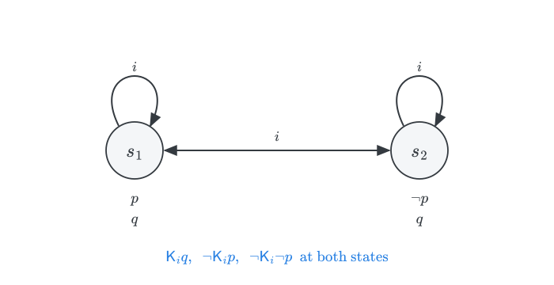{.nostretch width="45%" fig-align="center"}

::: {.incremental}
- $\textsf{K}_i q$ is true at both states.

- neither $\textsf{K}_i p$ nor $\textsf{K}_i \neg p$ is true at either state.
:::

## truth in a model

::: {.definition}
$\varphi$ is **true in** a model $M$, written $M \Vdash \varphi$, iff $M, s \Vdash \varphi$, for each $s \in W$.
:::

::: {.definition}
$\varphi$ is **valid in** a frame $F = (W, \{R_i : i \in I\})$, written $F \models \varphi$, iff $M \Vdash \varphi$, for each model $M$ based on the frame $F$.
:::
. . .

All substitution instances of $\textsf{K}$ are valid in all frames, and $\textsf{RN}$ preserves validity in all frames:

$$\varphi / \textsf{K}_i \varphi \tag{\textsf{RN}}$$
$$\textsf{K}_i (p \to q) \to (\textsf{K}_i p \to \textsf{K}_i q) \tag{\textsf{K}}$$

. . .

Agents know all logical truths, and they furthermore know what follows from what they know.

## $\textsf{M}$: knowledge commutes with conjunction 

$$\textsf{K}_i (\varphi \wedge \psi) \to (\textsf{K}_i \varphi \wedge \textsf{K}_i \psi) \tag{\textsf{M}}$$

::: {style="height: 40px;"}
:::

::: {.incremental}
- It follows from $\textsf{RN}$ and $\textsf{K}$: you know a conjunction iff you know each conjunct.

- Semantically, $\varphi \wedge \psi$ is true at a state iff $\varphi$ and $\psi$ both are.
:::

## logical omniscience 

Ordinary knowledge appears not to be closed under logical consequence, and ordinary agents do not know all logical truths. Many logical truths are far too complex for me to even entertain, much less know.

Two potential lines of response:

::: {.incremental}
- **idealization**: do not take $\textsf{K}_i$ to represent ordinary knowledge. Instead, $\textsf{K}_i$ is used to model the knowledge of idealized agents with unlimited logical capabilities.

- **implicit knowledge**: use $\textsf{K}_i$ to model what follows from knowledge we may reasonably attribute to ordinary agents, even if it is not explicitly known by them.
:::

# the logic of knowledge {.divider}

Which modal axioms are candidates for the logic of knowledge?

## $\textsf{T}$: what is known is true
 
::: {.columns}
::: {.column width="62%"}
$$\textsf{K}_i p \to p \tag{\textsf{T}}$$

::: {.incremental}
- knowledge entails truth

- $\textsf{T}$ requires each $R_i$ to be **reflexive** on $W$. 

- each state is a genuine epistemic option for an agent at that very state.
:::
:::

::: {.column width="38%"}
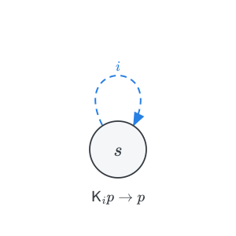{width="50%"}
:::
:::

## Moorean sentences are unknowable

Consider the sentence 'you do not know it, but your phone has been stolen'.
$$p \wedge \neg \textsf{K}_i p$$
This Moorean sentence may well be true, but could you ever come to know it? 

. . .

Not in the presence of  $\textsf{T}$ and $\textsf{M}$:  

- $p \wedge \neg \textsf{K}_i p$ is falsified at all states of all reflexive models.

- $\neg (p \wedge \neg \textsf{K}_i p)$ is valid in all reflexive frames.

## a theorem of epistemic logic

::: {.theorem}
$\vdash \neg \textsf{K}_i (p \wedge \neg \textsf{K}_i p)$
:::

::: {.proof}
We use instances of $\textsf{M}$ and $\textsf{T}$:
$$
\begin{array}{lll}
1 & \textsf{K}_i (p \wedge \neg \textsf{K}_i p) \to (\textsf{K}_i p \wedge \textsf{K}_i \neg \textsf{K}_i p) & \textsf{M}\\
2 & \textsf{K}_i \neg \textsf{K}_i p \to \neg \textsf{K}_i p & \textsf{T}\\
3 & (\textsf{K}_i p \wedge \textsf{K}_i \neg \textsf{K}_i p) \to (\textsf{K}_i p \wedge \neg \textsf{K}_i p) & \textsf{PL} \ 2\\
4 & \neg \textsf{K}_i (p \wedge \neg \textsf{K}_i p) & \textsf{PL} \ 1, 3
\end{array}
$$
:::

## $\textsf{B}$: what might be known is true 

The dual of $\textsf{T}$ claims that if something is true, then for all you know, it is true. 

$$p \to  \langle \textsf{K}_i \rangle p $$
$\textsf{B}$ claims that if something is true, then **you know that** for all you know, it is true.

$$p \to \textsf{K}_i \langle \textsf{K}_i \rangle p \tag{\textsf{B}}$$

The dual claims that if for all you know, you know something, then it is true.
$$\langle \textsf{K}_i \rangle \textsf{K}_i p \to p \tag{$\textsf{B}_\Diamond$}$$

. . .

**Whatever might be known is true**. If for all you know, you know that your phone has been stolen, then it has indeed been stolen.

## symmetry and skepticism

$\textsf{B}$ requires each $R_i$ to be **symmetric** on $W$. 

Williamson (2000, §8.2) links symmetry and to radical skepticism.

::: {.columns}
::: {.column width="48%"}

::: {.incremental}
- At $w$, $i$ believes that she has a hand. 

- At $v$, $i$ is systematically deceived into believing that despite being a brain in a vat.

- $R_ivw$. What $i$ knows at $v$ is true at $w$.

- By symmetry, $R_i w v$, and what $i$ knows at $w$ is true at $v$.

- The belief that $i$ has hand is false at $v$, and it is *not* knowledge at $w$.
:::
:::

::: {.column width="52%"}
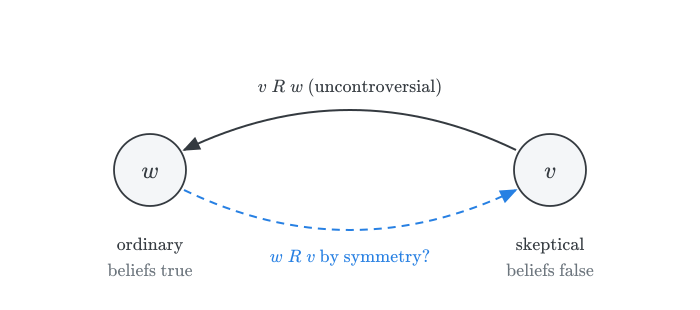{width="100%"}
:::
:::

## the case against $\textsf{B}$ 

Read as $\neg \varphi \to \textsf{K}_i \neg \textsf{K}_i \varphi$:

::: {.incremental}
- whenever you fail to know something because it is false, you know that you do not know it.

- The agent in $v$ does not know she is being deceived; she does not know she does not know.

- the rejection of $\textsf{B}$ as a *validity* is not to say that symmetric models are never appropriate, as in the phone example.
:::

## from $\textsf{B}$ to $\textsf{5}$

If $R_i$ is reflexive and euclidean on $W$, then $R_i$ is symmetric on $W$.

::: {.columns}
::: {.column width="50%"}
::: {.incremental}

- $\textsf{KTB} \sqsubseteq \textsf{KT5} = \textsf{S5}$.

- The case against $\textsf{B}$ is a case against $\textsf{5}$.
:::
:::

::: {.column width="50%"}
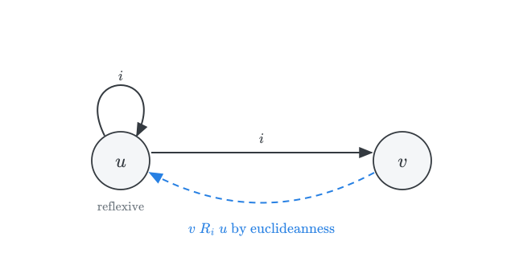{width="100%"}
:::
:::

## $\textsf{5}$: what is not ruled out is known to not be ruled out 

$$\langle \textsf{K}_i \rangle p \to \textsf{K}_i \langle \textsf{K}_i \rangle p \tag{\textsf{5}}$$

The dual axiom claims that if it is not ruled out that you know something, then you know it.
$$\langle \textsf{K}_i \rangle \textsf{K}_i p \to \textsf{K}_i p \tag{$\textsf{5}_\Diamond$}$$

. . .

::: {.columns}
::: {.column width="50%"}
I mistakenly take myself to know that my phone has been stolen. Unbeknownst to me, I just misplaced it. So, I do *not* know that it has been stolen. Yet, since I have not ruled out that I know it, by $\textsf{5}_\Diamond$, I **must** know it after all. 
:::

::: {.column width="50%"}
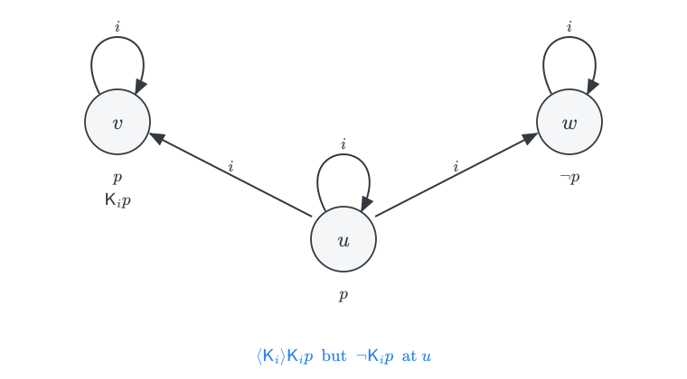{width="100%"}
:::
:::

## $\textsf{5}$, knowledge, and belief  {.smaller}

Add a belief operator $\textsf{B}_i$ governed by at least two principles:

$$
\begin{array}{lll}
\textsf{K}_i \varphi \to \textsf{B}_i \varphi & & \textsf{Knowledge entails Belief}\\ 
\textsf{B}_i \varphi \to \neg \textsf{B}_i \neg \varphi & & \textsf{Consistent Belief}
\end{array}
$$

Then $\textsf{5}$ yields 
$$
\begin{array}{lll}
\textsf{B}_i \textsf{K}_i \varphi \to \textsf{K}_i \varphi & & \textsf{Infallible Epistemic Belief} \\
\end{array}
$$

::: {.proof}
We combine $\textsf{5}$ with the two former principles:
$$
\begin{array}{lll}
1 & \neg \textsf{K}_i \varphi \to \textsf{K}_i \neg \textsf{K}_i \varphi & \textsf{5} \ \text{in the form } \neg\textsf{K}_i \to \textsf{K}_i \neg \textsf{K}_i\\
2 & \textsf{K}_i \neg \textsf{K}_i \varphi \to \textsf{B}_i \neg \textsf{K}_i \varphi & \textsf{Knowledge Entails Belief}\\
3 & \textsf{B}_i \neg \textsf{K}_i \varphi \to \neg \textsf{B}_i \textsf{K}_i \varphi & \textsf{Consistent Belief} \ \text{for} \ \textsf{B}_i\\
4 & \textsf{B}_i \textsf{K}_i \varphi \to \textsf{K}_i \varphi & \textsf{PL} \ 1, 2, 3
\end{array}
$$
:::

. . .

To believe that you know is, on this framework, sufficient to know. No one mistakenly believes that they know what they do not know.

## $\textsf{4}$: what is known is known to be known 

::: {.columns}
::: {.column width="48%"}
$$\textsf{K}_i p \to \textsf{K}_i \textsf{K}_i p \tag{\textsf{4}}$$

::: {.incremental}
- Otherwise known as the $\textsf{KK}$-principle. 

- Knowledge is transparent to the agent.

- Agents with unlimited introspection recognize their own knowledge: they have conclusive reasons that are not defeasible by new information.

- $\textsf{4}$ requires each $R_i$ to be **transitive** on $W$.

- Hintikka (1962) adopted $\textsf{KT4}$ (or $\textsf{S4}$) after dismissing $\textsf{B}$ and $\textsf{5}$ as implausible.
:::
:::

::: {.column width="52%"}
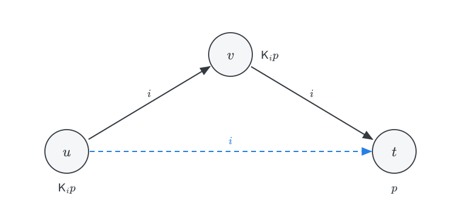{width="75%"}
:::
:::

## $\textsf{4}$: an objection from belief 

Given $\textsf{K}_i \varphi \to \textsf{B}_i \varphi$, axiom $\textsf{4}$ entails
$$\textsf{K}_i \varphi \to \textsf{B}_i \textsf{K}_i \varphi$$

::: {.proof}
We need only assume that Knowledge entails Belief.
$$
\begin{array}{lll}
1 & \textsf{K}_i \varphi \to \textsf{K}_i \textsf{K}_i \varphi & \textsf{4}\\
2 & \textsf{K}_i \textsf{K}_i \varphi \to \textsf{B}_i \textsf{K}_i \varphi & \textsf{Knowledge entails Belief}\\
3 & \textsf{K}_i \varphi \to \textsf{B}_i \textsf{K}_i \varphi & \textsf{PL} \ 1, 2
\end{array}
$$
:::

. . .

I know something only if I believe that I know it.

## margins for error 

Williamson (2000, ch. 5): you glance at a crowd and make an estimate. Let $p_k$ stand for the proposition that the actual count is $k$. 

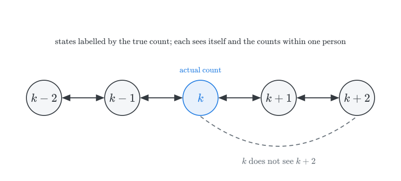{.nostretch width="50%" fig-align="center"}

. . .

A **margin of error principle**:
$$\textsf{K} \neg p_k \to \neg p_{k+1} \tag{\textsf{MEP}}$$
You know the count is not $k$ only if it is not $k+1$ either. This is because you cannot distinguish two crowds that differ just by one person. So, your belief would be true only by luck.

## why accept $\textsf{MEP}$?

::: {.incremental}
- Suppose the true count is $k+1$ and you believe it is not $k$.

- A crowd of $k$ would look exactly the same to you as this crowd.

- You would have formed the same belief had the count been $k$, and it would have been false.

- Your belief is true only by luck, and a belief that is true by luck is not knowledge.
:::

## the margin of error argument 

Suppose you are reflective enough to know every instance of $\textsf{MEP}$.

::: {.proof}
You know that the count is *not* $k$ only if you know that it is *not* $k+1$.
$$
\begin{array}{lll}
1 & \textsf{K} \neg p_k \to \textsf{K} \textsf{K} \neg p_k & \textsf{4}\\
2 & \textsf{K}(\textsf{K} \neg p_k \to \neg p_{k+1}) & \text{known instance of } \textsf{MEP}\\
3 & \textsf{K} \textsf{K} \neg p_k \to \textsf{K} \neg p_{k+1} & \textsf{K}, \ 2\\
4 & \textsf{K} \neg p_k \to \textsf{K} \neg p_{k+1} & \textsf{PL} \ 1, 3
\end{array}
$$
:::

. . .

::: {.incremental}
- You surely know the count is not $0$: $\textsf{K} \neg p_0$. 

- By induction, $\textsf{K} \neg p_n$ for every $n$, including the true count $k$.

- By $\textsf{T}$, $\neg p_k$, contradicting $p_k$.

- Williamson blames $\textsf{4}$: limited discrimination calls for non-transitive accessibility.
:::

## where this leaves us

::: {.columns}
::: {.column width="40%"}
::: {.incremental}
- $\textsf{T}$: accepted by all.

- $\textsf{B}$, $\textsf{5}$: rejected by most.

- $\textsf{4}$: contested. 

    Hintikka and Stalnaker support $\textsf{S4}$. 

    Williamson stays with $\textsf{KT}$.
:::
:::

::: {.column width="60%"}
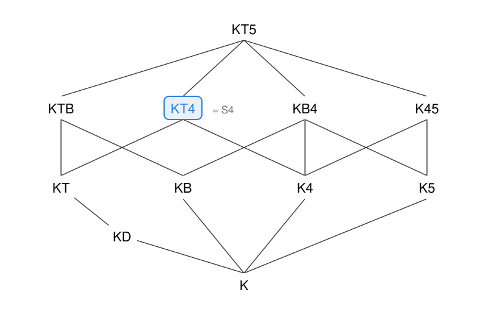{width="100%"}
:::
:::

For a survey of these debates, see Holliday, "Epistemic Logic and Epistemology" (2018), §7.

# the unexpected examination {.divider}

Margin of error principles reappear in a famous paradox.

## the paradox 

Teacher announces an exam next term that will come as a **surprise**: on the day of the exam, students will not know that it is that day.

::: {.incremental}
- The exam cannot be on the last day.
    
    Otherwise, students would know that it is that day.

- Having ruled out the last day, it cannot be on the penultimate day either. 

    If no exam has taken place by the penultimate day, it would be the only option left.

- Similar reasoning rules out every other day, until no day is left.

- Yet, teacher eventually gives the exam, and the students are surprised.
:::

## Glimpse 

Williamson (2000, ch. 6): the same issue arises in a much simpler case.

::: {.incremental}
- Students know the teacher circles all and only exam dates on her office calendar.

- From a distant glimpse, they see exactly one date circled. They are able to appreciate that it is not very near the end of term, but they cannot narrow it down much further.

- Let $e_n$: the exam takes place $n$ days before the end of term.

- Since the glimpse is imprecise, a margin of error principle applies, and the students know it:

    $$\textsf{K} \neg e_n \to \neg e_{n+1} \tag{\textsf{MEP}}$$

- From the glimpse, they know the exam is not on the last day: $\textsf{K} \neg e_0$.
:::

## the argument from Glimpse 

::: {.proof}
If students can rule out $e_{0}$, then they can rule out $e_{1}$:
$$
\begin{array}{lll}
1 & \textsf{K} \neg e_0 \to \textsf{K} \textsf{K} \neg e_0 & \textsf{4}\\
2 & \textsf{K}(\textsf{K} \neg e_0 \to \neg e_1) & \text{known instance of } \textsf{MEP}\\
3 & \textsf{K} \textsf{K} \neg e_0 \to \textsf{K} \neg e_1 & \textsf{K}, \ 2\\
4 & \textsf{K} \neg e_0 \to \textsf{K} \neg e_1 & \textsf{PL} \ 1, 3
\end{array}
$$
:::

. . .

In general:
$$\textsf{K} \neg e_n \to \textsf{K} \neg e_{n+1}$$

## ruling out every day

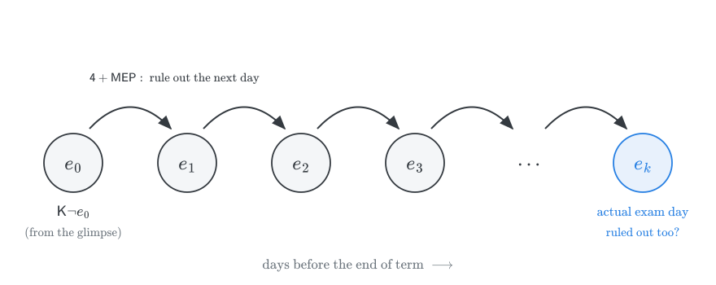{.nostretch width="80%" fig-align="center"}

::: {.incremental}
- Students start from $\textsf{K} \neg e_0$ and they are in a position to rule out *every* day of term.

- Yet, the exam takes place and they are surprised.

- For Williamson, the students' error is to rely on $\textsf{4}$.
:::

# knowability {.divider}

Of special interest is the interaction of epistemic and metaphysical modalities.

## what is the case can be known

Some philosophers hold that what is true never outstrips what can be known. If we read $\Diamond$ in terms of *metaphysical* possibility, the knowability principle becomes:
$$p \to \Diamond \textsf{K} p \tag{\textsf{Knowability}}$$

. . .

**Fitch's paradox.** Knowability, given modest principles, entails that every truth is *known*:
$$p \to \textsf{K} p \tag{\textsf{Knowledge}}$$

. . .

If $\textsf{Knowledge}$ fails, then there are Moorean truths. The thought is to apply Knowability to a Moorean truth. If, unbeknownst to you, your phone has been stolen, then $p \wedge \neg \textsf{K} p$ is an ordinary truth you could never come to know: as soon as you know $p$, the second conjunct becomes false. So, if $\textsf{Knowledge}$ fails, $\textsf{Knowability}$ must fail as well.

## the ingredients

::: {.incremental}
- For $\textsf{K}$: $\textsf{M}$ and $\textsf{T}$, which gave us the theorem $\neg \textsf{K}(p \wedge \neg \textsf{K}p)$.

- For $\Box$: the rule $\textsf{RN}$, and $\Diamond$ as the dual of $\Box$.

- A simple instance of $\textsf{Knowability}$ for a Moorean truth.

- Classical propositional logic.
:::

. . .

Notice how little is assumed: no $\textsf{4}$, no $\textsf{5}$, no full closure of knowledge.

## Fitch's argument

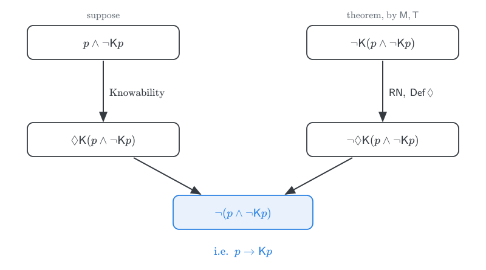{.nostretch width="68%" fig-align="center"}

## Fitch's argument, step by step

::: {.proof}
Here is a formal version of the argument:
$$
\begin{array}{lll}
1 & \textsf{K}(p \wedge \neg \textsf{K} p) \to (\textsf{K} p \wedge \textsf{K} \neg \textsf{K} p) & \textsf{M}\\
2 & \textsf{K} \neg \textsf{K} p \to \neg \textsf{K} p & \textsf{T}\\
3 & \neg \textsf{K}(p \wedge \neg \textsf{K} p) & \textsf{PL} \ 1, 2\\
\hline
4 & \Box \neg \textsf{K}(p \wedge \neg \textsf{K} p) & \textsf{RN} \ 3\\
5 & \neg \Diamond \textsf{K}(p \wedge \neg \textsf{K} p) & \textsf{Def} \ \Diamond \ 4\\
\hline
6 & (p \wedge \neg \textsf{K} p) \to \Diamond \textsf{K}(p \wedge \neg \textsf{K} p) & \textsf{Knowability}\\
7 & p \to \textsf{K} p & \textsf{PL} \ 5, 6
\end{array}
$$
:::

. . .

Three stages: Moorean truths are unknowable (1–3); as a matter of necessity (4–5); and thus $\textsf{Knowability}$ collapses into $p \to \textsf{K}p$ (6–7). 

If *all* truths are knowable, all truths are known.

## a semantic diagnosis

Making the agent explicit again, a model for the hybrid language requires two accessibility relations: $R_i$ for $i$'s knowledge and $R_\Diamond$ for metaphysical possibility.

::: {.incremental}
- **RN in line 4** presupposes that line 3 is true at *every* $R_\Diamond$-accessible world. Since line 3 depends on $\textsf{T}$, $R_i$ must be reflexive at every world.

- **$\Diamond$ shifts the world of evaluation**, including for the inner $\neg \textsf{K}_i p$.
:::

. . .

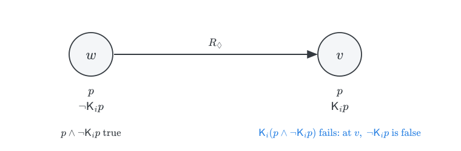{.nostretch width="62%" fig-align="center"}

## what is the problem

::: {.incremental}
- For $\textsf{Knowability}$ to be true at $w$, $\textsf{K}_i(p \wedge \neg \textsf{K}_i p)$ must be true at some $R_\Diamond$-accessible world.

- To know the conjunction requires one to know $p$: it must be a world like $v$, where $i$ knows $p$.

- But at $v$, the second conjunct says that $i$ does not know $p$ *at $v$*, not at $w$. Since knowledge is factive, $i$ cannot know the conjunction at $v$.

- What we want is a world where $i$ knows $p$ and knows she *did not* know $p$ at $w$. 

    $\textsf{K}_i(p \wedge \neg \textsf{K}_i p)$ cannot express this: the inner $\textsf{K}_i$ concerns $i$'s state at the world of evaluation.

- On this view, the paradox arises because some truths concern the agent's own epistemic situation, and coming to know them makes them false.
:::

## where to resist

::: {.incremental}
- **Logic**: the final step to $p \to \textsf{K}p$ is not intuitionistically valid. Some anti-realists reject classical logic.

- **Restriction** (Tennant): restrict Knowability to *Cartesian* truths, those $\varphi$ for which $\textsf{K}\varphi$ is consistent. Since $\textsf{K}(p \wedge \neg \textsf{K}p)$ is inconsistent by $\textsf{M}$ and $\textsf{T}$, the instance in line 6 is blocked.

- **Interpretation** (van Benthem): read $\Diamond \textsf{K}\varphi$ dynamically, as *one could come to know $\varphi$ by learning something true*. Learning $p \wedge \neg \textsf{K}p$ makes it false. 

    We will return to this idea when we discuss information flow.
:::

