# information flow {.divider}

Agents locate themselves in the space of epistemic alternatives by ruling out states in light of new information.

## learning as ruling out

Recall your phone: nothing you know enables you to distinguish $s_1$ from $s_2$.

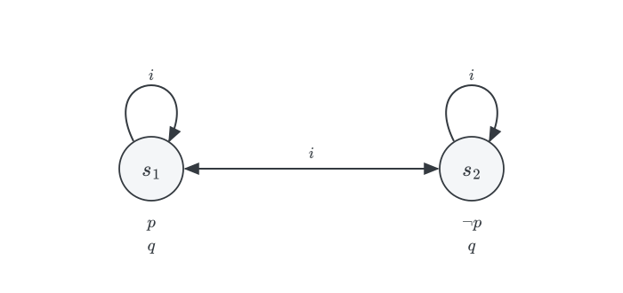{.nostretch width="40%" fig-align="center"}

::: {.incremental}
- Knowledge locates the actual state within the space of live alternatives.

- To *learn* a proposition is to rule out some alternatives where it fails. To learn that your phone has been stolen is to rule out $s_2$.

- We want to articulate a model of how public information changes what agents know.
:::

# the muddy children {.divider}

## the puzzle 

Three children, $a$, $b$, and $c$, come in from playing outside. Two of them, $a$ and $c$, have mud on their foreheads. No child can see their own forehead, but each can see the others'.

::: {.columns}
::: {.column width="50%"}
::: {.incremental}
- *A*. The guardian makes an announcement:  

    *At least one of you is muddy.*

- *B*. She asks: 

    *If you know you are muddy, please step forward.* 
    
    No one steps forward.

- *C*. She repeats the request. 
  
    $a$ and $c$ step forward, $b$ stays behind.
:::
:::

::: {.column width="50%"}
Three questions:

::: {.incremental}
- Did the children learn anything from *A*? Each of them could already see a muddy child.
- What changed between *B* and *C*?
- How did $a$ and $c$ come to know that they were muddy?
:::
:::
:::

## states as triples 

::: {.columns}
::: {.column width="52%"}
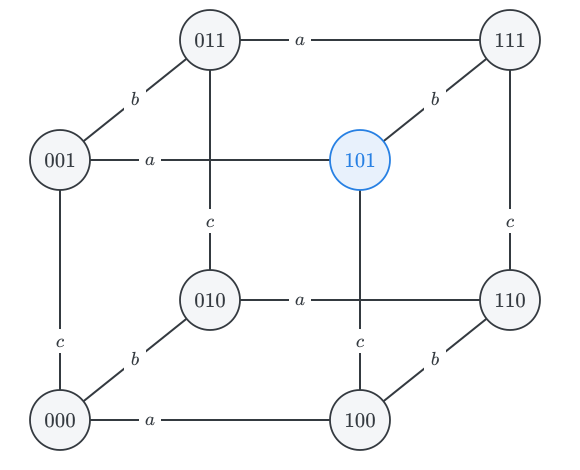{width="100%"}
:::

::: {.column width="48%"}
::: {.incremental}
- A state records who is muddy, in the order $a, b, c$. The actual state is $101$.

- Eight states. An edge labelled $i$ joins two states that child $i$ cannot tell apart.

- Two states are $i$-linked iff they differ *only* in $i$'s forehead: $i$ sees everything else.

- Each $R_i$ is reflexive; the loops are omitted.

- $p_1, p_2, p_3$ state that $a$, $b$, $c$, respectively, are muddy.
:::
:::
:::

## what each child knows at $101$

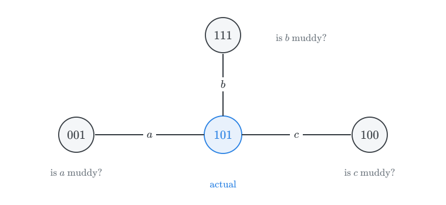{.nostretch width="58%" fig-align="center"}

::: {.incremental}
- $a$ cannot rule out $001$: $\neg \textsf{K}_a p_1 \wedge \neg \textsf{K}_a \neg p_1$. Yet $\textsf{K}_a p_3$ and $\textsf{K}_a \neg p_2$.

- Each child is in your situation with the phone; they do not know whether they are muddy.
:::

## why equivalence relations? 

The accessibility relations are reflexive and *symmetric*, and *transitive*: each $R_i$ is an equivalence relation, so the logic of each child's knowledge is $\textsf{S5}$.

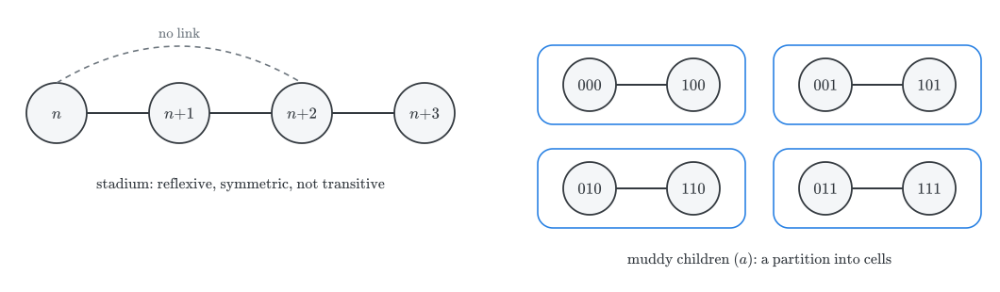{.nostretch width="85%" fig-align="center"}

::: {.incremental}
- States are indistinguishable if they look alike to the child, and that is an equivalence relation.

- Whether $\textsf{B}$, $\textsf{4}$, and $\textsf{5}$ are appropriate depends on the source of the information.
:::

## announcement A {.smaller}

::: {.columns}
::: {.column width="52%"}
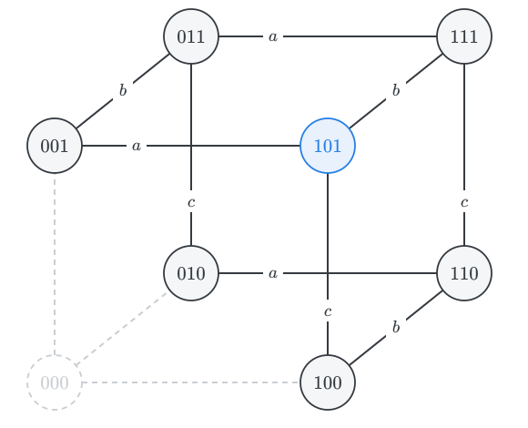{width="100%"}
:::

::: {.column width="48%"}
::: {.incremental}
- *A* rules out $000$.

- But no child regarded $000$ as a live option: from $101$, each child sees some muddy forehead.

- So *A* does provides no new information *about who is muddy*.

- It nevertheless makes a difference: the states adjacent to $000$ have changed. Child $c$ at $001$ now knows she is muddy.
:::
:::
:::

## request B: ignorance is informative 

::: {.columns}
::: {.column width="52%"}
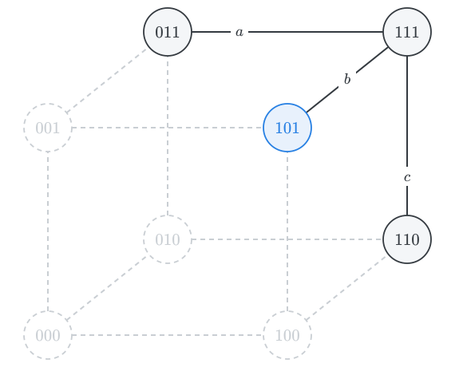{width="100%"}
:::

::: {.column width="48%"}
::: {.incremental}
- No one steps forward: each child learns that *no child knows that they are muddy*.

- At a state with exactly one muddy child, that child sees no mud on the others. After *A*, she would know she is muddy, and would step forward.

- So $100$, $010$, and $001$ are ruled out.

- At $101$, $a$ can no longer consider $001$, and $c$ can no longer consider $100$.
:::
:::
:::

## request C 

::: {.columns}
::: {.column width="52%"}
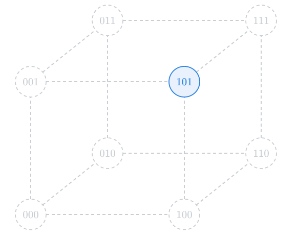{width="100%"}
:::

::: {.column width="48%"}
::: {.incremental}
- $a$ and $c$ step forward: they find no live alternative at which they are clean.

- $b$ stays behind: she still cannot tell $101$ from $111$.

- The fact that $a$ and $c$ step forward and $b$ stay behind rules out every alternative to $101$. 
    
    At $111$, for example, no one would step forward.

- Now everyone knows who is muddy.
:::
:::
:::

## the complete story

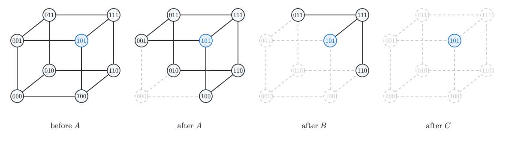{.nostretch width="100%" fig-align="center"}

::: {.incremental}
- Each step eliminates states. Nothing is ever added.

- With $k$ muddy children among $n$, no one steps forward until the $k$-th request, at which point exactly the $k$ muddy children step forward.
:::

# updates {.divider}

## updating a model 

The diagrams suggest an update mechanism: once $\varphi$ is announced, eliminate all $\neg \varphi$-states.

If $M = (W, \{R_i : i \in I\}, V)$, the **update** of $M$ by $\varphi$ is: 

::: {.columns}
::: {.column width="52%"}

::: {.definition}
$M|\varphi = (W', \{R'_i : i \in I\}, V')$, where:

1. $W' = \{s \in W : M, s \Vdash \varphi\}$,
2. $R'_i = R_i \cap (W' \times W')$, and
3. $V'(p) = V(p) \cap W'$.
:::
:::

::: {.column width="48%"}

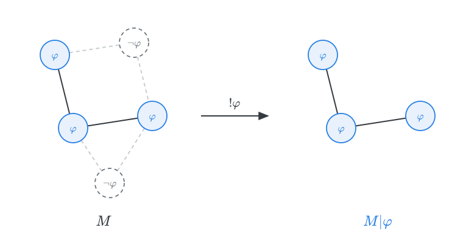{.nostretch width="100%" fig-align="center"}
:::
:::

## public announcements

Add an operator $[!\varphi]$, where $[!\varphi]\psi$ is read: *after the announcement of $\varphi$, $\psi$*.

::: {.definition}
$$
\begin{array}{lll}
M, s \Vdash [!\varphi]\psi & \text{iff} & M, s \Vdash \varphi \ \text{only if} \ M|\varphi, s \Vdash \psi
\end{array}
$$
:::

::: {.incremental}
- The antecedent reflects the assumption that announcements are **true**: a false announcement cannot be made, so $[!\varphi]\psi$ is vacuously true where $\varphi$ fails.

- $[!\varphi]$ is a box-like operator, but it does not quantify over accessible states of *one* model. It shifts the evaluation to a *new* model.
:::

## the muddy children, formalized 

::: {.incremental}
- *A* is the announcement
$$p_1 \vee p_2 \vee p_3$$
The effect of the update by that formula is to remove $000$ from the initial model.

- The silence after *B* amounts to an announcement that no child knows that they are muddy:
$$\neg \textsf{K}_a p_1 \wedge \neg \textsf{K}_b p_2 \wedge \neg \textsf{K}_c p_3$$
The effect of the update is to remove states at which exactly one child is muddy.

- The response after *C* announces that $a$ and $c$, but not $b$, know that they are muddy.
  $$\textsf{K}_a p_1 \wedge \neg \textsf{K}_b p_2 \wedge \textsf{K}_c p_3$$
 The effect of that update is to rule out $110$, $011$, and $111$ in the updated model.
:::

## how to learn from the ignorance of others

::: {.incremental}
- The announcement *A* makes concerns the mud. *B* and *C* concern what the children *know*.

- The children learn from each other's ignorance: $a$ learns that she is muddy from the fact that $c$ did not know that $c$ was muddy.

- The same announcement has different effects at different times: the second request is informative because the model has changed in the meantime.
:::

# Moore and Fitch revisited {.divider}

## Moorean announcements 

::: {.columns}
::: {.column width="55%"}

Suppose I tell you: 

*your phone has been stolen, but you do not know it.*

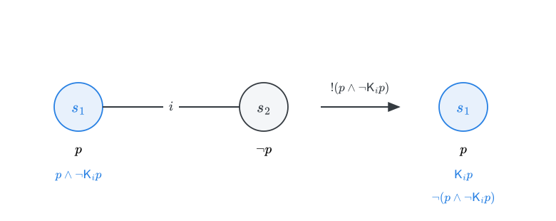{.nostretch width="100%" fig-align="center"}
:::

::: {.column width="45%"}
::: {.incremental}
- The announcement is true at $s_1$, and the update removes $s_2$.

- In the updated model, you know $p$, and the formula becomes *false*:
$$[!(p \wedge \neg \textsf{K}_i p)] \neg (p \wedge \neg \textsf{K}_i p)$$

- This is the dynamic counterpart of the fact that Moorean sentences are unknowable: they can be announced, but not learned.
:::
:::
:::

## back to knowability 

Recall van Benthem's reading of $\Diamond \textsf{K} \varphi$: *one could come to know $\varphi$ by learning something*.

::: {.incremental}
- In the present framework: $\varphi$ is knowable at $s$ iff for some $\psi$ true at $s$, $M, s \Vdash [!\psi]\textsf{K}_i \varphi$.

- Truths are often knowable: when $\varphi$ contains no epistemic operators, announce $\varphi$ itself: $[!\varphi]\textsf{K}_i\varphi$, and you will come to know $\varphi$.

- But the Moorean truth $p \wedge \neg \textsf{K}_i p$ is not knowable. Once you learn that $p$, the second conjunct becomes false.

- This matches the semantic diagnosis of Fitch: some truths concern the agent's epistemic situation, and they cannot be learned without changing the epistemic situation of the subject.

:::

# the unexpected examination, revisited {.divider}

The update framework provides a new view of the unexpected examination paradox.

## the simplest case

Gerbrandy (2007): the exam is either on Monday ($m$) or on Tuesday ($t$), but not both. On Sunday, the student cannot tell the two states apart.

. . .

What does it mean for the exam to be a surprise?

::: {.incremental}
- If the exam is on Monday, the student must not know on Sunday that it is on Monday.

- If it is on Tuesday, the student must not know it is on Tuesday even after learning, on Monday, that there was no exam that day.
:::

. . .

The teacher's announcement is therefore:
$$S \ = \ (m \wedge \neg \textsf{K}_i m) \vee (t \wedge [!\neg m]\neg \textsf{K}_i t)$$

## evaluate $S$

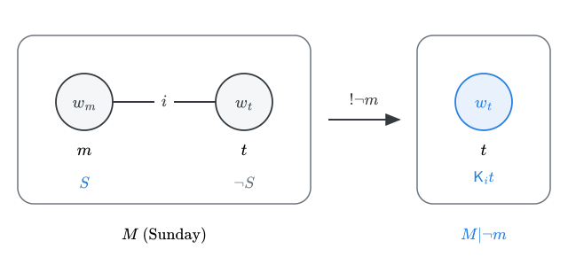{.nostretch width="58%" fig-align="center"}

::: {.incremental}
- At $w_m$: $m$ is true and $w_t$ is still open, so $\neg \textsf{K}_i m$ holds, and $S$ is true.

- At $w_t$: the update by $\neg m$ leaves only $w_t$, so the student would know $t$, and $S$ is false.

- So the students' first step is sound: if the announcement is true, the exam is not on Tuesday.
:::

## an unsuccessful announcement

Now suppose the teacher announces $S$, and the students take her at her word.

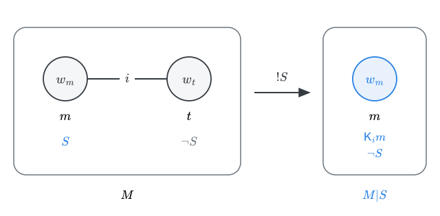{.nostretch width="50%" fig-align="center"}

::: {.incremental}
- The update by $S$ removes $w_t$ and leaves only $w_m$. At $w_m$, students know $m$, so $S$ is false:
$$M, w_m \Vdash S \wedge [!S]\neg S$$

- The announcement can be true when made, but it cannot survive being accepted. 
:::

## longer terms 

With three days, let $d_n$ say that the exam is on day $n$:
$$
S \ = \ (d_1 \wedge \neg \textsf{K}_i d_1) \ \vee \ (d_2 \wedge [!\neg d_1] \neg \textsf{K}_i d_2) \ \vee \ (d_3 \wedge [!\neg d_1][!\neg d_2] \neg \textsf{K}_i d_3)
$$

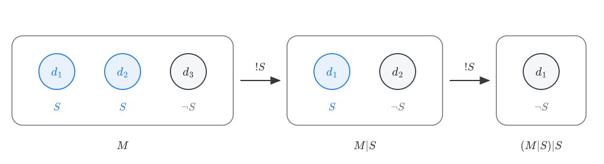{.nostretch width="50%" fig-align="center"}

::: {.incremental}
- The first elimination remains sound: $S$ is false at $d_3$, so the update by $S$ removes it.

- But in $M|S$, $S$ itself fails at $d_2$, so the student no longer knows $S$:
$$M, d_1 \Vdash [!S](S \wedge \neg \textsf{K}_i S)$$

- The backward induction proceeds as if the student could keep eliminating days on the strength of an announcement she continues to know. That assumption is exactly what fails.
:::

## Kripke

The model makes precise a diagnosis due to Kripke (2011).

::: {.incremental}
- The students may know the announcement when it is made. What they cannot do is *retain* that knowledge as they acquire more information.

- As the exam-free days go by, they forget nothing, but what they learn undermines their knowledge of the announcement.
:::

