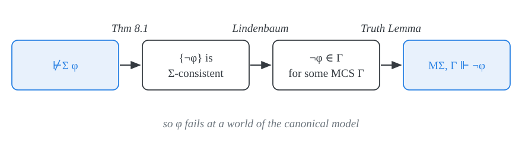
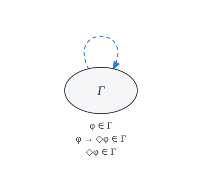
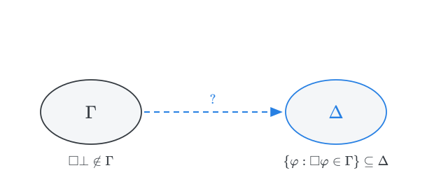
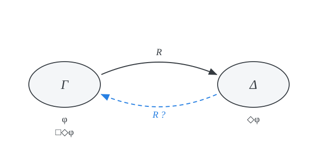
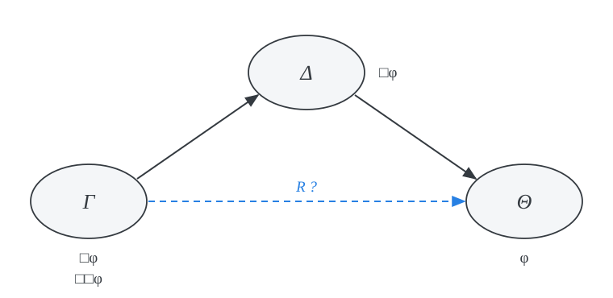
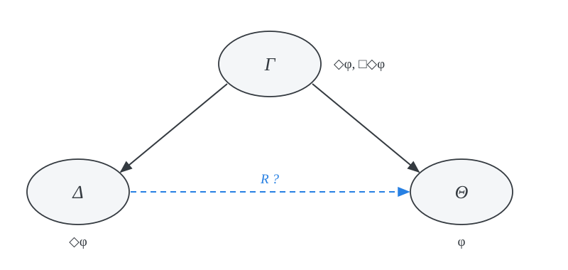
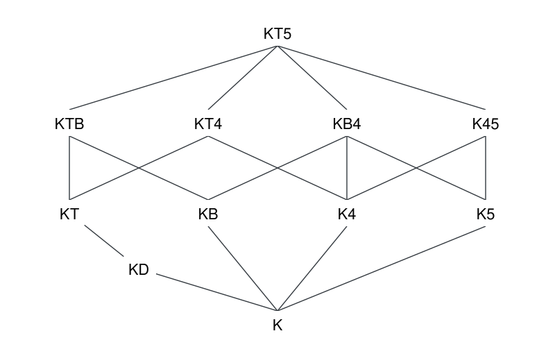
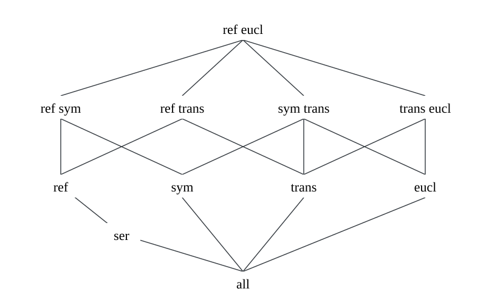
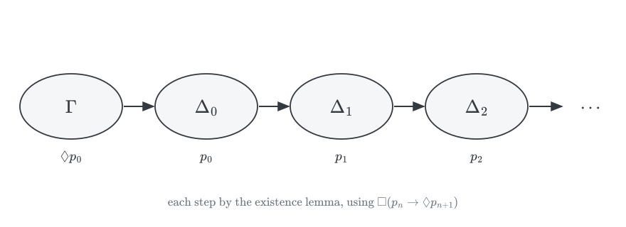
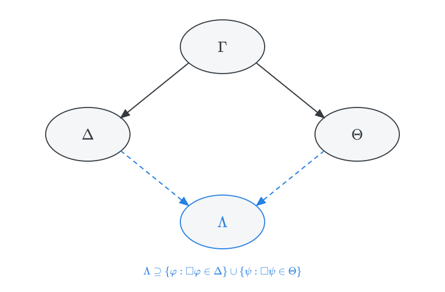

# completeness {.divider}

Given a normal modal system $\Sigma$, if $\varphi$ is a modal formula:

$$
\begin{array}{lll}
\nvdash_\Sigma \varphi & \Rightarrow & \text{for some max $\Sigma$-con $\Gamma$}, \mathcal{M}_\Sigma, \Gamma \nVdash \varphi \\
                       & \Rightarrow & (W_\Sigma, R_\Sigma) \not \models \varphi\\
\end{array}
$$
So, if the canonical frame $(W_\Sigma, R_\Sigma)$ for $\Sigma$ is in $\mathcal{C}$, then $\Sigma$ is complete with respect to $\mathcal{C}$.

## completeness of $\textsf{K}$ {.smaller}

::: {.theorem}
If $\models \varphi$, then $\vdash_{\textsf{K}} \varphi$.
:::

::: {.proof}
We rehearse the same argument again:

::: {.incremental}
- Suppose $\nvdash_{\textsf{K}} \varphi$. Then $\neg \varphi$ is $\textsf{K}$-consistent.

- By Lindenbaum's lemma, $\{\neg\varphi\}$ may be extended to a maximal $\textsf{K}$-consistent set $\Gamma$.

- $\Gamma \in W_{\textsf{K}}$, and, by the truth lemma, $\mathcal{M}_{\textsf{K}}, \Gamma \Vdash \neg  \varphi$.

- So $\mathcal{M}_{\textsf{K}}, \Gamma \nVdash \varphi$. Hence $\not\models \varphi$.
:::
:::

## modal completeness beyond $\textsf{K}$ {.smaller}

{.nostretch width="80%" fig-align="center"}

Consider the case of $\textsf{KT}$. If $\nvdash_{KT} \varphi$, then the argument above yields that there is some $\Gamma \in W_{\textsf{KT}}$ for which $\mathcal{M}_{\textsf{KT}}, \Gamma \nVdash \varphi$. But notice that a **further step** is required to justify completeness with respect to the class of **reflexive** frames.

The fact that $\mathcal{M}_{\textsf{KT}} \nVdash \varphi$ will help **only if** the canonical frame $(W_{\textsf{KT}}, R_{\textsf{KT}})$ for $\textsf{KT}$ is reflexive. That is, if $R_{\textsf{KT}}$ is reflexive on $W_{\textsf{KT}}$.

## completeness of $\textsf{KT}$ {.smaller}

::: {.columns}
::: {.column width="62%"}
$\textsf{KT}$ is complete with respect to the class of all reflexive frames:

::: {.theorem}
If $\models_{\text{ref}} \varphi$, then $\vdash_{\textsf{KT}} \varphi$.
:::

::: {.proof}
We argue that $R_{\textsf{KT}}$ is reflexive on $W_{\textsf{KT}}$: $\Gamma R_{\textsf{KT}} \Gamma$ for each $\Gamma \in W_{\textsf{KT}}$.

That is, if $\Gamma$ is a maximal $\textsf{KT}$-consistent set, then for each modal formula $\varphi$:

- if $\varphi \in \Gamma$, then $\Diamond \varphi \in \Gamma$.

Fix $\varphi \in \Gamma$. Since $\vdash_{\textsf{KT}} \varphi \to \Diamond \varphi$, $\varphi \to \Diamond \varphi \in \Gamma$. By closure under $\textsf{MP}$, $\Diamond \varphi \in \Gamma$.
:::
:::

::: {.column width="38%"}
{width="100%"}
:::
:::

# canonicity {.divider}

## the canonical model is a model of $\Sigma$ {.smaller}

::: {.theorem}
For every formula $\varphi$: $\ \mathcal{M}_\Sigma \Vdash \varphi$ iff $\vdash_\Sigma \varphi$.
:::

::: {.proof}
The argument is simple.

($\Leftarrow$) Every maximal $\Sigma$-consistent set contains all theorems of $\Sigma$, so by the truth lemma all theorems is true at all worlds of $\mathcal{M}_\Sigma$.

($\Rightarrow$) If $\nvdash_\Sigma \varphi$, then $\neg\varphi$ belongs to some maximal $\Sigma$-consistent set $\Gamma$, and $\mathcal{M}_\Sigma, \Gamma \nVdash \varphi$.
:::

. . .

::: {.incremental}
- So the canonical *model* verifies all and only theorems of $\Sigma$.

- The question now is whether theorems of $\Sigma$ are **valid** in the canonical frame for $\Sigma$. That is, are the theorems of $\Sigma$ true under **every** valuation, not just under $V_\Sigma$?

- Completeness with respect to $\mathcal{C}$ only requires the frame to be in $\mathcal{C}$. Canonicity asks for more: that the frame validate $\Sigma$.
:::

## canonical axioms and systems 

::: {.definition}
$\Sigma$ is a **canonical** normal system iff the canonical frame for $\Sigma$ validates all theorems of $\Sigma$.
:::

. . .

::: {.definition}
An axiom is **canonical** iff whenever a normal system $\Sigma$ contains its substitution instances, its canonical frame $(W_\Sigma, R_\Sigma)$ validates them.
:::

## five canonical axioms {.smaller}

::: {.theorem}
Whenever a normal system $\Sigma$ contains its substitution instances, $R_\Sigma$ satisfies the relevant condition.
:::

::: {.columns}
::: {.column width="50%"}
| | axiom | condition on $R_\Sigma$ |
|--|--|--|
| $\textsf{D}$ | $\Box p \to \Diamond p$ | serial |
| $\textsf{T}$ | $\Box p \to p$ | reflexive |
| $\textsf{B}$ | $p \to \Box \Diamond p$ | symmetric |
| $\textsf{4}$ | $\Box p \to \Box \Box p$ | transitive |
| $\textsf{5}$ | $\Diamond p \to \Box \Diamond p$ | euclidean |
:::

::: {.column width="50%"}

::: {style="height: 40px;"}
:::

For example:

::: {.incremental}
- $R_\textsf{KD}$ is serial on $W_\textsf{KD}$

- $R_\textsf{KT}$ is reflexive on $W_\textsf{KT}$

- $R_\textsf{KB}$ is symmetric on $W_\textsf{KB}$

- $R_\textsf{K4}$ is transitive on $W_\textsf{K4}$

- $R_\textsf{K5}$ is euclidean on $W_\textsf{K5}$
:::
:::
:::

## from frame conditions to canonicity {.smaller}

We proceed to argue that $R_\Sigma$ satisfies the relevant **condition** in each case. 

To conclude that the axiom is **canonical**, we rely on a further observation:

::: {.incremental}
- for a frame to satisfy the condition is sufficent for the frame to **validate** the axiom.

- So if $R_\Sigma$ satisfies the condition, the canonical frame validates the axiom.
:::

. . .

$$
\Sigma \ \text{contains all instances of the axiom} \ \Rightarrow \ R_\Sigma \ \text{satisfies the condition} \ \Rightarrow \ (W_\Sigma, R_\Sigma) \ \text{validates all instances of the axiom}
$$

## the pattern {.smaller}

In each case, we argue that $R_\Sigma$ relates certain maximal consistent sets:

::: {.incremental}
- We unpack the condition in terms of the definition of $R_\Sigma$ in either the $\Box$ or $\Diamond$ form.

- Use the axiom, whose instances belong to each $\Gamma \in W_\Sigma$, to move a formula from one set to another.

- In the diagrams below, solid arrows are given and the dashed arrow is to be shown.
:::

## a useful lemma {.smaller}

Several proofs, including the existence lemma, use one crucial step.

::: {.theorem}
If $\vdash_\Sigma (\varphi_1 \wedge \dots \wedge \varphi_n) \to \psi$, then $\vdash_\Sigma (\Box\varphi_1 \wedge \dots \wedge \Box\varphi_n) \to \Box\psi$.
:::

::: {.proof}
By $\textsf{RK}$, $\vdash_\Sigma \Box(\varphi_1 \wedge \dots \wedge \varphi_n) \to \Box\psi$. It remains to verify that
$$\vdash_\Sigma (\Box\varphi_1 \wedge \dots \wedge \Box\varphi_n) \to \Box(\varphi_1 \wedge \dots \wedge \varphi_n)$$.
:::

. . .

With $\psi = \bot$, this is the step used for $\textsf{D}$ below.

## $\textsf{D}$: seriality {.smaller}

::: {.columns}
::: {.column width="60%"}

::: {.theorem}
If $\Sigma$ includes substitution instances of $\textsf{D}$, then $R_\Sigma$ is serial on $W_\Sigma$: if $\Gamma$ is a max $\Sigma$-con set, there is $\Delta$ with $\{\varphi : \Box\varphi \in \Gamma\} \subseteq \Delta$.
:::

::: {.proof}
We argue that $\{\varphi : \Box \varphi \in \Gamma\}$ is $\Sigma$-consistent. Suppose not. Then $\vdash_\Sigma (\varphi_1 \wedge \dots \wedge \varphi_n) \to \bot$ for some $\Box\varphi_1, \dots, \Box\varphi_n \in \Gamma$. By the lemma, 

$$\vdash_\Sigma (\Box\varphi_1 \wedge \dots \wedge \Box\varphi_n) \to \Box \bot.$$

It follows that $\Box\bot \in \Gamma$. Given axiom $\textsf{D}$, $\Diamond \bot \in \Gamma$. But $\vdash_\Sigma \Box \neg \bot$, i.e., $\neg\Diamond\bot \in \Gamma$. So, $\Gamma$ is $\Sigma$-inconsistent, which contradicts the assumption that $\Gamma$ is a max $\Sigma$-con set.
:::
:::

::: {.column width="40%"}
{width="100%"}
:::
:::

## $\textsf{B}$: symmetry {.smaller}

::: {.columns}
::: {.column width="55%"}
::: {.theorem}
If $\Sigma$ includes substitution instances of $\textsf{B}$, then $R_\Sigma$ is symmetric on $W_\Sigma$: if $\Gamma, \Delta$ are max $\Sigma$-con sets, then if $\Gamma R_\Sigma \Delta$, then $\Delta R_\Sigma \Gamma$.
:::

::: {.proof}
Given maximal $\Sigma$-consistent sets $\Gamma, \Delta$, we argue that

- if $\{\varphi : \Box\varphi \in \Gamma\} \subseteq \Delta$, then $\{\Diamond \varphi : \varphi \in \Gamma\} \subseteq \Delta$.

Let $\varphi \in \Gamma$. By $\textsf{B}$, $\varphi \to \Box \Diamond \varphi \in \Gamma$, so $\Box\Diamond\varphi \in \Gamma$. Since $\Gamma R_\Sigma \Delta$, $\Diamond \varphi \in \Delta$.
:::
:::

::: {.column width="45%"}
{width="100%"}
:::
:::

## $\textsf{4}$: transitivity {.smaller}

::: {.columns}
::: {.column width="50%"}

::: {.theorem}
If $\Sigma$ includes substitution instances of $\textsf{4}$, then $R_\Sigma$ is transitive on $W_\Sigma$: if $\Gamma, \Delta, \Theta$ are max $\Sigma$-con sets, then if $\Gamma R_\Sigma \Delta$ and $\Delta R_\Sigma \Theta$, then $\Gamma R_\Sigma \Theta$.
:::

::: {.proof}
Given maximal $\Sigma$-consistent sets $\Gamma, \Delta, \Theta$, we argue

- if $\{\varphi : \Box\varphi \in \Gamma\} \subseteq \Delta$ and $\{\varphi : \Box\varphi \in \Delta\} \subseteq \Theta$, then $\{\varphi : \Box\varphi \in \Gamma\} \subseteq \Theta$

Assume $\{\varphi : \Box\varphi \in \Gamma\} \subseteq \Delta$ and $\{\varphi : \Box\varphi \in \Delta\} \subseteq \Theta$. Let $\Box \varphi \in \Gamma$. By $\textsf{4}$, $\Box\Box\varphi \in \Gamma$. Since $\Gamma R_\Sigma \Delta$, $\Box \varphi \in \Delta$. Since $\Delta R_\Sigma \Theta$, $\varphi \in \Theta$.
:::
:::

::: {.column width="50%"}

::: {style="height: 100px;"}
:::

{width="80%"}
:::
:::

## $\textsf{5}$: euclidean condition {.smaller}

::: {.columns}
::: {.column width="50%"}

::: {.theorem}
If $\Sigma$ includes substitution instances of $\textsf{5}$, then $R_\Sigma$ is euclidean on $W_\Sigma$: if $\Gamma, \Delta, \Theta$ are max $\Sigma$-con sets, then if $\Gamma R_\Sigma \Delta$ and $\Gamma R_\Sigma \Theta$, then $\Delta R_\Sigma \Theta$.
:::

::: {.proof}
Given maximal $\Sigma$-consistent sets $\Gamma, \Delta, \Theta$, we argue

- if $\{\varphi : \Box\varphi \in \Gamma\} \subseteq \Delta$ and $\{\varphi : \Box\varphi \in \Gamma\} \subseteq \Theta$, then $\{\varphi : \Box\varphi \in \Delta\} \subseteq \Theta$

Assume $\{\varphi : \Box\varphi \in \Gamma\} \subseteq \Delta$ and $\{\varphi : \Box\varphi \in \Gamma\} \subseteq \Theta$. Let $\varphi \in \Theta$. Since $\Gamma R_\Sigma \Theta$, $\Diamond \varphi \in \Gamma$. By $\textsf{5}$, $\Box \Diamond\varphi \in \Gamma$. Since $\Gamma R_\Sigma \Delta$, $\Diamond \varphi \in \Delta$.
:::
:::

::: {.column width="50%"}

::: {style="height: 100px;"}
:::

{width="80%"}
:::
:::

# completeness for the landscape {.divider}

## how to combine canonical axioms {.smaller}

::: {.theorem}
If $\Sigma$ extends $\textsf{K}$ with the canonical axioms that correspond to conditions $C_1, \dots, C_n$, then $\Sigma$ is complete with respect to the class of frames that satisfy $C_1, \dots, C_n$.
:::

. . .

::: {.proof}
If $\nvdash_\Sigma \varphi$, then $\varphi$ fails at some world of $\mathcal{M}_\Sigma$. Since $\Sigma$ contains all instances of each axiom, $R_\Sigma$ satisfies all of $C_1, \dots, C_n$. Thus $\varphi$ fails on a frame in the class.
:::

. . .

For example, $R_{\textsf{S4}}$ is reflexive and transitive, and $R_{\textsf{S5}}$ is reflexive and euclidean.

## strong completeness {.smaller}

The canonical model gives us more than we have used.

::: {.theorem}
If $\Gamma \nvdash_\Sigma \varphi$, then $\Gamma \cup \{\neg\varphi\}$ is true at some world of $\mathcal{M}_\Sigma$.
:::

::: {.proof}
$\Gamma \cup \{\neg\varphi\}$ is $\Sigma$-consistent (Theorem 8.1). By Lindenbaum's lemma, it extends to a maximal $\Sigma$-consistent set $\Delta$. By the truth lemma, every member of $\Gamma \cup \{\neg\varphi\}$ is true at $\Delta$.
:::

. . .

Given a canonical system $\Sigma$ and the relevant class $\mathcal{C}$: if a world in a model on a frame in $\mathcal{C}$ that verifies $\Gamma$ verifies $\varphi$ true, then $\Gamma \vdash_\Sigma \varphi$. 

## the full picture {.smaller}

::: {.columns}
::: {.column width="50%"}
{width="100%"}
:::

::: {.column width="50%"}
{width="100%"}
:::
:::

Combined with **soundness**, each system in the landscape **characterizes** the corresponding class of frames. Soundness holds because each axiom is valid on the frames that satisfy its condition (frame definability), and $\textsf{MP}$ and $\textsf{RN}$ preserve validity on any class of frames.

# the limits of the method {.divider}

Not every normal system is canonical.

## $\textsf{GL}$ {.smaller}

$\textsf{GL}$ extends $\textsf{K}$ with all instances of Löb's axiom:
$$\Box(\Box p \to p) \to \Box p \tag{\textsf{L}}$$

::: {.incremental}
- Löb's axiom is valid on a frame iff the frame is *transitive* and *conversely well-founded*: there is no infinite chain $w_0 R w_1 R w_2 R \cdots$.

- $\textsf{GL}$ is sound and complete with respect to this class of frames, and even with respect to the finite, transitive, irreflexive frames.

- But the canonical frame for $\textsf{GL}$ is **not** conversely well-founded.
:::

## why $\textsf{GL}$ is not canonical {.smaller}

{.nostretch width="72%" fig-align="center"}

::: {.incremental}
- The set $\{\Diamond p_0\} \cup \{\Box(p_n \to \Diamond p_{n+1}) : n \geq 0\}$ is $\textsf{GL}$-consistent: each finite subset is true at the root of a long enough finite chain. Extend it to a maximal $\textsf{GL}$-consistent $\Gamma$. 

- Since $\Diamond p_0 \in \Gamma$, there is $\Delta_0$ with $\Gamma R_{GL} \Delta_0$ and $p_0 \in \Delta_0$. Since axiom **4** each instance of $\Box(p_k\to\Diamond p_{k+1})$ is placed into each $\Delta_n$. So $p_n \to \Diamond p_{n+1}\in\Delta_n$, hence $\Diamond p_{n+1}\in\Delta_n$, and the existence lemma gives $\Delta_{n+1}$ with $p_{n+1}\in\Delta_{n+1}$.

- So the canonical frame contains an infinite chain, and it does not validate Löb's axiom. Completeness of $\textsf{GL}$ requires the use of alternative methods, such as filtrations and finite models.

:::

## exercise: $\textsf{S4.2}$ {.smaller}

::: {.columns}
::: {.column width="55%"}
$\textsf{S4.2}$ extends $\textsf{S4}$ with all instances of
$$\Diamond\Box p \to \Box\Diamond p \tag{\textsf{.2}}$$

$\textsf{.2}$ is canonical for **directed** frames: if $\Gamma R_\Sigma \Delta$ and $\Gamma R_\Sigma \Theta$, then there is $\Lambda$ with $\Delta R_\Sigma \Lambda$ and $\Theta R_\Sigma \Lambda$.

*Hint*: show that $\{\varphi : \Box\varphi \in \Delta\} \cup \{\psi : \Box\psi \in \Theta\}$ is $\Sigma$-consistent, and use Lindenbaum's lemma.
:::

::: {.column width="45%"}
{width="100%"}
:::
:::
