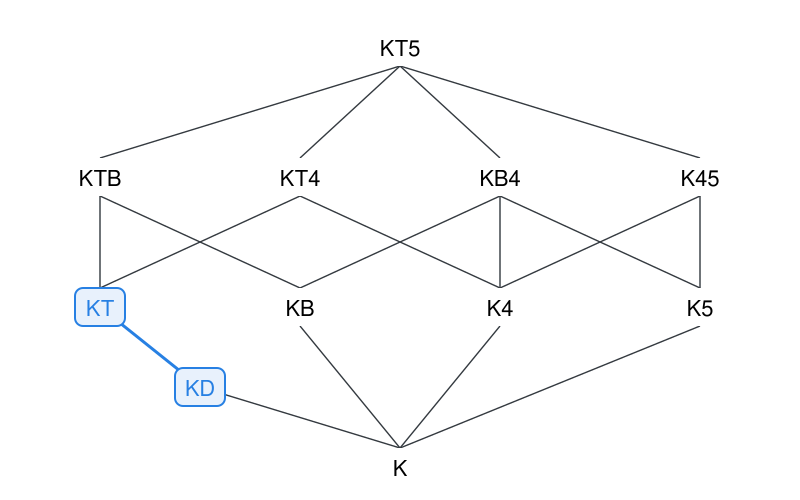
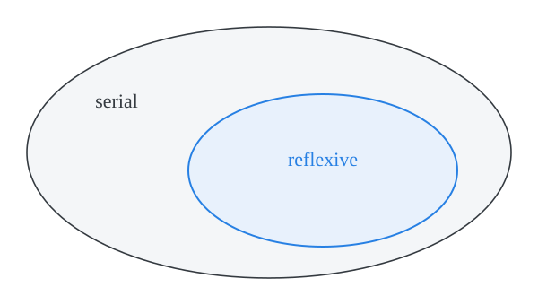
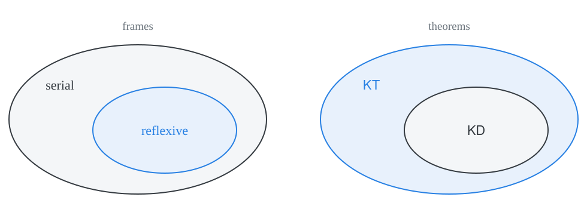
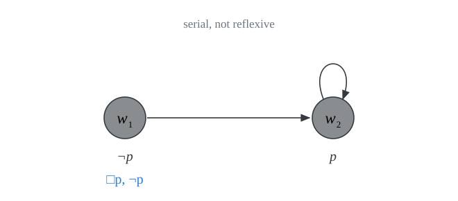
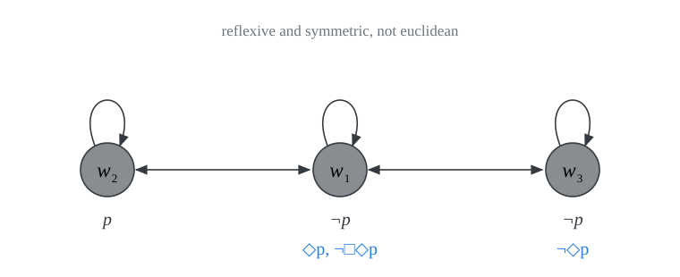
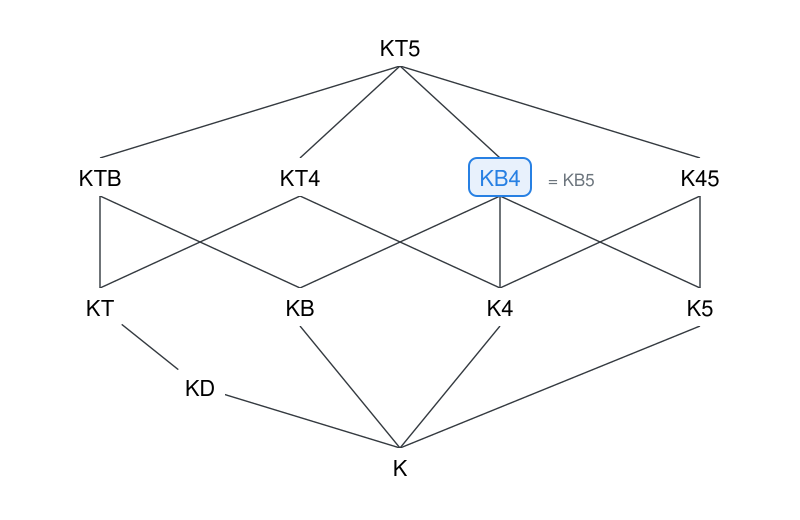
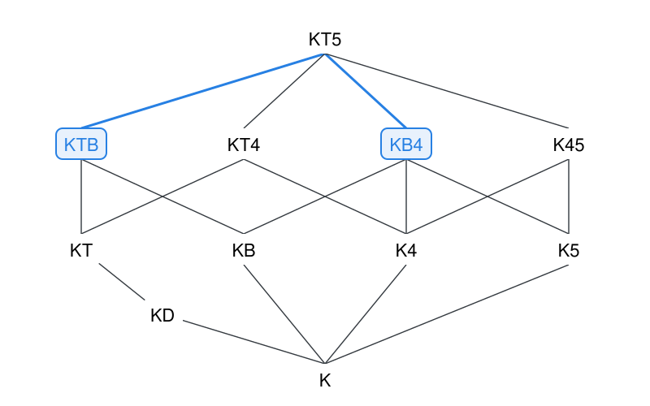

# normal modal logics {.divider}

We now look at axiom systems that extend the minimal normal modal logic $\textsf{K}$ with all substitution instances of several further modal axioms.

## normal modal logics 

::: {.definition}
A **normal modal logic** $\Sigma$ is an axiom system that results from $\textsf{K}$ when we add to its axioms all substitution instances of further modal axioms.
:::

. . .

::: {style="height: 10px;"}
:::

:::{.incremental}
- We keep the same rules of inference: $\textsf{MP}$ and $\textsf{RN}$.

- Derived rules of inference such as $\textsf{PL}$, $\textsf{RK}$, and $\textsf{RK}_\Diamond$ remain available for each normal logic.

- We use the name of the added axioms to name each extension of $\textsf{K}$: $\textsf{KT}$, $\textsf{KB}$, $\textsf{K4}$, $\textsf{KB4}$, $\dots$
:::

## three important normal systems

:::{.columns}
::: {.column width="60%"}
::: {.definition}
$\textsf{KT}$ extends $\textsf{K}$ with $\Box p \to p \tag{\textsf{T}}$
:::

::: {.definition}
$\textsf{KT4}$ extends $\textsf{KT}$ with $\Box p \to \Box \Box p$
:::

::: {.definition}
$\textsf{KT5}$ extends $\textsf{KT}$ with $\Diamond p \to \Box \Diamond p$
:::
:::

::: {.column width="40%"}
$$
\begin{array}{llc}
\textsf{T} & \Box p \to p & \quad \\
\textsf{B} & p \to \Box \Diamond p \\
\textsf{4} & \Box p \to \Box \Box p \\
\textsf{5} & \Diamond p \to \Box \Diamond p\\
\textsf{D} & \Box p \to \Diamond p & & & \\
\end{array}
$$

:::
:::
. . .

We write $\vdash_{\textsf{KT}} \varphi$, $\vdash_{\textsf{KT4}} \varphi$, $\vdash_{\textsf{KT5}} \varphi$. Two notable systems are $\textsf{S4} = \textsf{KT4}$ and $\textsf{S5} = \textsf{KT5}$.

## axioms and their duals

Each axiom is interderivable with its modal dual:

$$
\begin{array}{llcll}
\textsf{T} & \Box p \to p & \quad & p \to \Diamond p & \textsf{T}_\Diamond\\
\textsf{B} & p \to \Box \Diamond p & & \Diamond \Box p \to p & \textsf{B}_\Diamond\\
\textsf{4} & \Box p \to \Box \Box p & & \Diamond \Diamond p \to \Diamond p & \textsf{4}_\Diamond\\
\textsf{5} & \Diamond p \to \Box \Diamond p & & \Diamond \Box p \to \Box p & \textsf{5}_\Diamond\\
\textsf{D} & \Box p \to \Diamond p & & & \\
\end{array}
$$

. . .

The recipe for the proof is to substitute $\neg p$ for $p$, contrapose, and apply $\textsf{Def} \ \Diamond$.

When we do this for $\textsf{D}$, we obtain $\textsf{D}$ back:

$$
\begin{array}{lclcl}
\Box \neg p \to \Diamond \neg p & \Leftrightarrow & \neg \Diamond \neg p \to \neg \Box \neg p  
                                & \Leftrightarrow & \Box p \to \Diamond p \\
\end{array}
$$

## $\textsf{KT} \vdash \textsf{T}_\Diamond$ 

::: {.theorem}
$\vdash_{\textsf{KT}} p \to \Diamond p$
:::

::: {.proof}
We apply the recipe. Substitute $\neg p$ for $p$, contrapose, and apply $\textsf{Def} \ \Diamond$.
$$
\begin{array}{lllll}
1 & & \Box \neg p \to \neg p & \textsf{T}[\neg p/p]\\
2 & & \neg \neg p \to \neg \Box \neg p & \textsf{PL} \ 1\\
3 & & \neg \neg p \to \Diamond p & \textsf{Def} \ \Diamond \ 2 \\
4 & & p \to \Diamond p & \textsf{PL} \ 3 \\
\end{array}
$$
:::

## $\textsf{KT}_\Diamond \vdash \textsf{T}$ {.smaller}

::: {.theorem}
$\vdash_{\textsf{KT}_\Diamond} \Box p \to p$
:::

::: {.proof}
We now retrace our steps.
$$
\begin{array}{lllll}
1 & & \neg p \to \Diamond \neg p & \textsf{T}_\Diamond[\neg p/p]\\
2 & & \neg p \to \neg \Box \neg \neg p & \textsf{Def} \ \Diamond \ 1 \\
3 & & \Box \neg \neg p \to p & \textsf{PL} \ 2 \\
4 & & p \to \neg \neg p & \textsf{PL} \\
5 & & \Box p \to \Box \neg \neg p & \textsf{RK} \ 4 \\
6 & & \Box p \to p & \textsf{PL} \ 3, 5 \\
\end{array}
$$
:::

. . .

Note the role of $\textsf{RK}$ in line 5: we cannot just cancel $\neg\neg$ *inside* the scope of $\Box$ by $\textsf{PL}$.

# the landscape of normal modal logics {.divider}

We are now in a positiont to compare different normal modal systems.

## extension

::: {.definition}
A normal modal system $\Sigma$ **extends** another system $\Delta$, written $\Delta \sqsubseteq \Sigma$, iff every theorem of $\Delta$ is a theorem of $\Sigma$. That is, for each $\varphi$ of $\mathcal{L}^\Box$, $$\text{if} \ \vdash_\Delta \varphi \ \text{then} \ \vdash_\Sigma \varphi.$$
:::

. . .

::: {.definition}
$\Sigma$ is a **proper extension** of $\Delta$, written $\Delta \sqsubset \Sigma$, iff $\Delta \sqsubseteq \Sigma$ but $\Sigma \not\sqsubseteq \Delta$.
:::

. . .

Two systems are the **same** when each extends the other: $\Delta \sqsubseteq \Sigma$ and $\Sigma \sqsubseteq \Delta$.

## eleven normal modal systems

::: {.columns}
::: {.column width="35%"}
How to read the diagram:

If $\Sigma$ is above $\Delta$ and joined to it by an edge, then $\Delta \sqsubset \Sigma$.

::: {style="height: 10px;"}
:::

::: {.fragment}
Two questions for each edge:

- why does the system above extend the system below?
- why is the extension proper?
:::
:::

::: {.column width="65%"}
{width="100%"}
:::
:::

## the semantic counterpart

::: {.columns}
::: {.column width="50%"}
{width="100%"}
:::

::: {.column width="50%"}
{width="100%"}
:::
:::

Each normal modal system will turn out to be sound and complete with respect to the corresponding class of frames. 

# how to show that $\Delta \sqsubseteq \Sigma$ {.divider}

## $\Sigma$ proves the axioms of $\Delta$

::: {.theorem}
$\Delta \sqsubseteq \Sigma$ iff $\Sigma$ proves each axiom of $\Delta$.
:::

::: {.proof}
$\Delta$ and $\Sigma$ share the basic rules of inference $\textsf{MP}$ and $\textsf{RN}$. So if each axiom of $\Delta$ is a theorem of $\Sigma$, each line of a proof in $\Delta$ is a theorem of $\Sigma$.
:::

. . .

Since normal modal systems share the axioms of $\textsf{K}$, in practice, we need only look at the relevant additions to $\textsf{K}$. For example, to prove that $\textsf{KD} \sqsubseteq \textsf{KT}$, we need only check that every instance of $\textsf{D}$ is a theorem of $\textsf{KT}$.

## $\textsf{KD} \sqsubseteq \textsf{KT}$

::: {.columns}
::: {.column width="45%"}
::: {.theorem}
$\vdash_{\textsf{KT}} \Box \varphi \to \Diamond \varphi$
:::

::: {.proof}
We combine $\textsf{T}$ and its dual $\textsf{T}_\Diamond$:
$$
\begin{array}{lllll}
1 & & \Box \varphi \to \varphi & \textsf{T}[\varphi/p] \\
2 & & \varphi \to \Diamond \varphi & \textsf{T}_\Diamond[\varphi/p]\\
3 & & \Box \varphi \to \Diamond \varphi & \textsf{PL} \ 1, 2\\
\end{array}
$$
:::
:::

::: {.column width="55%"}
{width="100%"}
:::
:::

## a semantic route {.smaller}

::: {.definition}
A normal modal system $\Sigma$ is **sound with respect to** a class of frames $\mathcal{C}$ iff for every $\varphi$, $\vdash_\Sigma \varphi$ only if $\models_{\mathcal{C}} \varphi$.
:::

::: {.definition}
A normal modal system $\Sigma$ is **complete with respect to** a class of frames $\mathcal{C}$ iff for every $\varphi$, $\vdash_\Sigma \varphi$ only if $\models_{\mathcal{C}} \varphi$.
:::

::: {.columns}
::: {.column width="60%"}
::: {.incremental}
- $\textsf{KD}$ is sound and complete with respect to serial frames.

- $\textsf{KT}$ is sound and complete with respect to reflexive frames.

- Each theorem of $\textsf{KD}$ is valid in all serial frames. (Soundness for $\textsf{KD}$)

- Every reflexive frame is serial.

- Each theorem of $\textsf{KD}$ is valid in all reflexive frames. 

- Each theorem of $\textsf{KD}$ is a theorem of $\textsf{KT}$. (Completeness for $\textsf{KT}$)
:::
:::

::: {.column width="40%"}
{width="100%"}
:::
:::

## the reversal

{.nostretch width="85%" fig-align="center"}

::: {.incremental}
- The fewer the frames, the more valid formulas. That is why the class of reflexive frames gives rise to *more* valid formulas than the class of *serial* frames.

- $\textsf{KD} \sqsubseteq \textsf{KT}$ mirrors the fact that $\text{reflexive} \subseteq \text{serial}$.
:::

# how to show that $\Delta \not\sqsubseteq \Sigma$ {.divider}

## find a countermodel

::: {.theorem}
Suppose each theorem of $\Sigma$ is valid in every frame in $\mathcal{C}$. Then $\Delta \not\sqsubseteq \Sigma$ if some axiom of $\Delta$ is not true in some model based on some frame in $\mathcal{C}$.
:::

::: {.proof}
If some axiom $\varphi$ of $\Delta$ is not true in some model based on some frame in $\mathcal{C}$, then $\varphi$ is *not* valid in every frame in $\mathcal{C}$. It follows that $\varphi$ is *not* a theorem of $\Sigma$. So, not every theorem of $\Delta$ is a theorem of $\Sigma$.
:::

. . .

The recipe: find a model based on some frame in $\mathcal{C}$ in which some axiom of $\Delta$ fails.

## $\textsf{KT} \not\sqsubseteq \textsf{KD}$ {.smaller}

$\textsf{KD}$ is sound with respect to the class of serial frames: each theorem of $\textsf{KD}$ is valid in all serial frames. $\textsf{T}$ is not true in models based on some serial frame:

{.nostretch width="50%" fig-align="center"}

::: {.incremental}
- $w_1 \Vdash \Box p$ because $w_2$ is the only world accessible from $w_1$ and $w_2$ is a $p$-world in the model. Yet, $w_1$ is *not* a $p$-world. Thus $(W, R, V), w_1 \nVdash \Box p \to p$.

- Hence $\textsf{KD} \not \sqsubseteq \textsf{KT}$.
:::

## $\textsf{KB5} \not\sqsubseteq \textsf{KTB}$ {.smaller}

$\textsf{KTB}$ is sound with respect to the class of reflexive and symmetric frames: each theorem of $\textsf{KTB}$ is valid in all reflexive and symmetric frames. Yet, $\textsf{5}$ is not true in some models based on a reflexive and symmetric frame:

{.nostretch width="55%" fig-align="center"}

::: {.incremental}
- $w_1 \Vdash \Diamond p$, since $w_2$ is a $p$-world accessible from $w_1$.

- Since $w_3 \nVdash \Diamond p$, and $w_3$ is accessible from $w_1$, $w_1 \nVdash \Box \Diamond p$.

- $(W, R, V), w_1 \nVdash \Diamond p \to \Box \Diamond p$.
:::

# where is $\textsf{KB5}$? {.divider}

::: {.columns}
::: {.column width="50%"}
What exactly is the place of $\textsf{KB5}$ in the landscape of normal modal systems?

::: {.incremental}
- $\textsf{KB5}$ extends $\textsf{KB}$
- $\textsf{KB5}$ extends $\textsf{K5}$
:::
:::

::: {.column width="50%"}
{width="100%"}
:::
:::

## $\textsf{KB4} \sqsubseteq \textsf{KB5}$ {.smaller}

::: {.theorem}
$\vdash_{\textsf{KB5}} \Box \varphi \to \Box \Box \varphi$
:::

::: {.proof}
We use $\textsf{B}$ to move from $\Box \varphi$ to $\Box \Diamond \Box \varphi$, and we use $\textsf{RK}$ to rewrite under $\Box$.
$$
\begin{array}{lllll}
1 & & \Box \varphi \to \Box \Diamond \Box \varphi & \textsf{B}[\Box \varphi/p]\\
2 & & \Diamond \Box \varphi \to \Box \varphi & \textsf{5}_\Diamond [\varphi/p]\\
3 & & \Box \Diamond \Box \varphi \to \Box \Box \varphi & \textsf{RK} \ 2 \\
4 & & \Box \varphi \to \Box \Box \varphi & \textsf{PL} \ 1, 3\\
\end{array}
$$
:::

## $\textsf{KB5} \sqsubseteq \textsf{KB4}$ {.smaller}

::: {.theorem}
$\vdash_{\textsf{KB4}} \Diamond \varphi \to \Box \Diamond \varphi$
:::

::: {.proof}
We use a similar pattern with $\textsf{4}_\Diamond$ in place of $\textsf{5}_\Diamond$.
$$
\begin{array}{lllll}
1 & & \Diamond \varphi \to \Box \Diamond \Diamond \varphi & \textsf{B}[\Diamond \varphi/p]\\
2 & & \Diamond \Diamond \varphi \to \Diamond \varphi & \textsf{4}_\Diamond[\varphi/p] \\
3 & & \Box \Diamond \Diamond \varphi \to \Box \Diamond \varphi & \textsf{RK} \ 2\\
4 & & \Diamond \varphi \to \Box \Diamond \varphi & \textsf{PL} \ 1, 3\\
\end{array}
$$
:::

## $\textsf{KB4} = \textsf{KB5}$

::: {.columns}
::: {.column width="38%"}
::: {.incremental}
- Each system extends the other, which means that they share the same theorems.

- $\textsf{KB4}$ sits above $\textsf{K5}$: $\textsf{5}$ is a theorem of $\textsf{KB4}$.

- From a semantic point of view, a symmetric frame is transitive iff it is euclidean.
:::
:::

::: {.column width="62%"}
{width="100%"}
:::
:::

## incomparable systems

::: {.columns}
::: {.column width="38%"}
::: {.incremental}
- $\textsf{KB5} \not\sqsubseteq \textsf{KTB}$: $\textsf{5}$ fails in models based on reflexive and symmetric frames.

- $\textsf{KB4} \not\sqsubseteq \textsf{KTB}$, as $\textsf{KB4} = \textsf{KB5}$.

- Is $\textsf{KTB} \sqsubseteq \textsf{KB4}$? No, $\textsf{T}$ fails in models based on symmetric and transitive frames.

- Hint: consider a model with a *dead end*.
:::
:::

::: {.column width="62%"}
{width="100%"}
:::
:::
